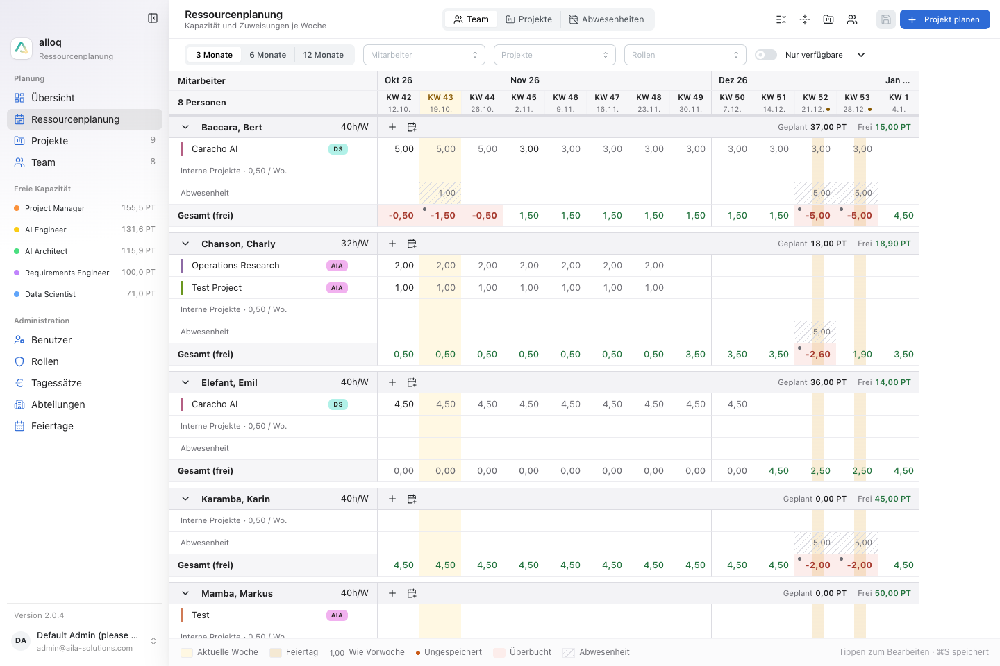
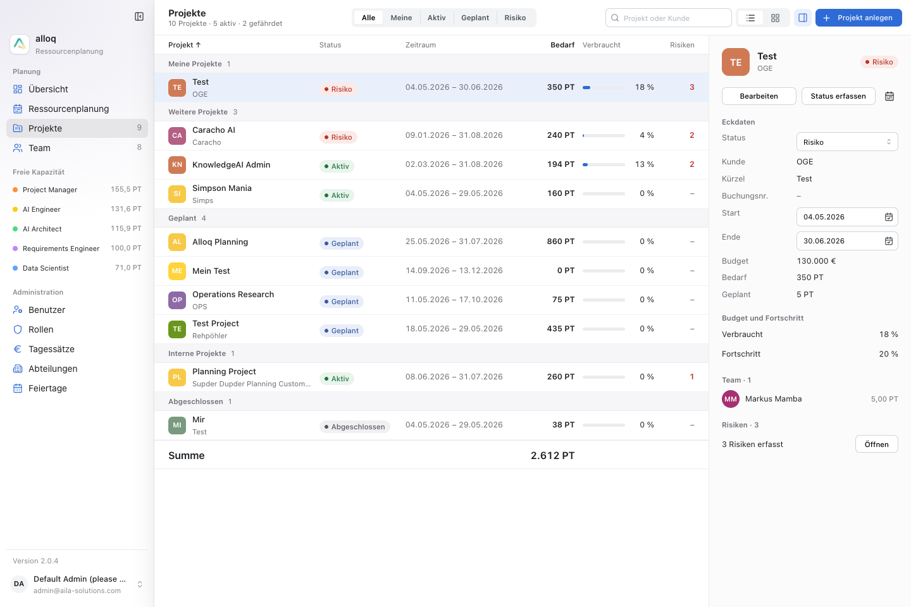
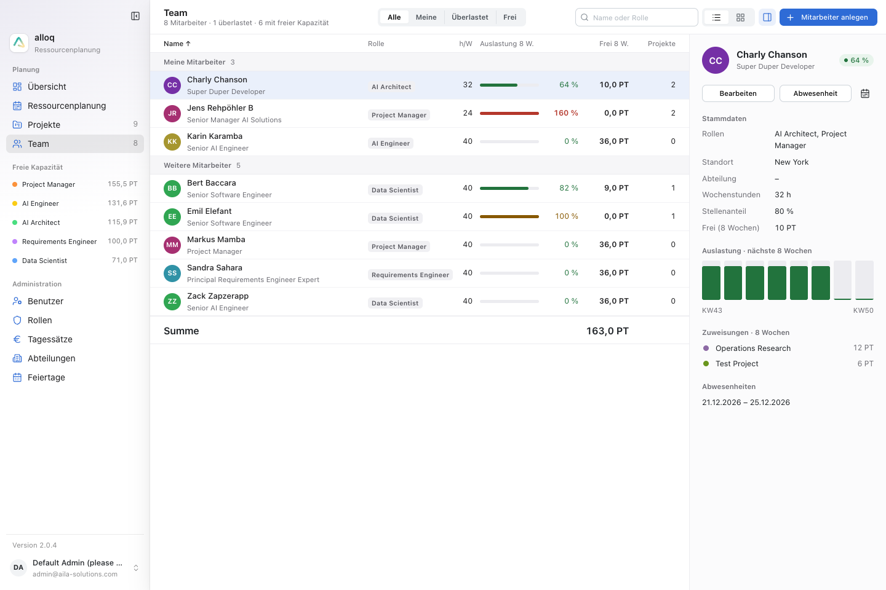

<div align="center">
  

# Alloq

  **Resource management & capacity planning for software teams**

  
  [](LICENSE.md)
  [](https://www.python.org)
  [](https://reflex.dev)

  [Features](#features) • [Documentation](#documentation) • [Getting Started](#getting-started) • [Development](#development) • [Deployment](#deployment)
</div>

---

Alloq helps software teams plan which people work on which project in each week. It counts the free capacity of each person after absences, public holidays, part time and internal work, and it shows the state of all projects on one page. Alloq runs in the browser, and there is also a macOS desktop app that works on the same central database.

## Features

- **Resource Planning** — Weekly capacity grid that you edit like a spreadsheet, with filters and an absence timeline
- **Staffing** — Staff a project with the "Projekt planen" wizard or person by person in the project drawer
- **Projects** — Project cards and an inspector with status, period, status reports, earned value chart and risks
- **Portfolio Overview** — Health of all projects at a glance, with time and progress, risk grid and staffing capacity
- **Team** — Employees, roles, seniority levels, departments and absences
- **Master Data** — Roles, departments, region-aware public holidays and daily rates with margin-based pricing
- **Authentication** — Email and password sign-in and Microsoft sign-in (Entra ID)
- **Role-Based Access** — Administrators can do everything, project managers edit planning, employees only read
- **Desktop App** — macOS app (Tauri) that signs in with Entra ID and connects to Postgres with a personal token

## Documentation

The developer documentation starts at [docs/index.md](docs/index.md). It covers setup, architecture, the user stories of each feature, and reference pages, and it describes v2.0.4.

```bash
# Install the docs dependencies once
task docs:install

# Start the docs site with live reload
task docs:dev
```

## Tech Stack

| Layer | Technology |
| ----- | ---------- |
| Framework | [Reflex](https://reflex.dev) 0.10.0 (full-stack Python) |
| UI Components | [appkit_mantine](https://github.com/jenreh/appkit) (Mantine 9.5) |
| Database | PostgreSQL 15 + SQLModel/SQLAlchemy 2.0 |
| Migrations | Alembic (manually authored) |
| Auth | appkit-user (session-based + OAuth) |
| Desktop | Tauri + reflex-desktop |
| Docs | VitePress |
| Task Runner | [Task](https://taskfile.dev) |
| Package Manager | [uv](https://docs.astral.sh/uv/) |

## Getting Started

The full walkthrough is in [Getting started](docs/guide/getting-started.md). The short version follows.

### Prerequisites

- [uv](https://docs.astral.sh/uv/) package manager (`task init` installs Python 3.14 with it)
- [Task](https://taskfile.dev) runner
- PostgreSQL 15+ (or the `db` service in Docker Compose)
- [ty](https://github.com/astral-sh/ty) on your `PATH` for `task typecheck`
- Node.js, only for the docs and the JavaScript tests

### Configuration

Settings come from the YAML files in `configuration/` and from environment variables. Put your local values in a `.env` file in the repo root:

```bash
PROFILES=local
SECRET_PROVIDER=local
UV_PROJECT_ENVIRONMENT=.venv.mac
```

`PROFILES=local` loads `configuration/config.local.yaml` on top of `configuration/config.yaml`. With `SECRET_PROVIDER=local`, the `secret:` values in the config are read from environment variables, for example `ALLOQ_DB_USER` for `secret:alloq-db-user`. The [Getting started](docs/guide/getting-started.md#secrets) guide lists every secret the local profile needs.

To use the Compose database, start only that service. It listens on host port `5433`:

```bash
docker compose up -d db
```

### Installation

```bash
# Clone the repository
git clone https://github.com/jenreh/alloq.git
cd alloq

# Initialize project (installs Python, syncs deps, sets up pre-commit, runs migrations)
task init
```

`task init` runs the migrations, so the database must be reachable at this point.

### Running

```bash
# Start the development server
task run

# Or with debug logging
task run:debug
```

With the `local` profile, the app is available at `http://localhost:8080/alloq`.

## Development

### Project Structure

```text
app/                    # Host Reflex app (pages, admin pages, desktop sign-in, styles)
components/
  alloq-commons/       # Shared entities, repositories, models, services, excel_grid
  alloq-dashboard/     # Portfolio overview (aggregation, charts)
  alloq-project/       # Project planning & forecasting
  alloq-team/          # Team management views
configuration/         # YAML config files (per-environment profiles)
alembic/               # Database migrations
docs/                  # Developer documentation (VitePress)
tauri/                 # macOS desktop app shell
scripts/               # Desktop build and helper scripts
tests/                 # Integration tests
```

Each `components/*` package is a uv workspace member with its own `pyproject.toml` and test suite.

### Common Tasks

```bash
task run        # Start the app with hot reload
task test       # Run tests with coverage
task lint       # Lint with ruff
task format     # Auto-format with ruff
task typecheck  # Type check app/ with ty
task db:upgrade # Apply pending migrations
task db:revision -- "description"  # Create new migration
task desktop:dev  # Run the desktop app against the local database
```

The JavaScript tests of the planning grid have no task. Run them with Node.js:

```bash
node --test "components/*/tests/js/*.test.mjs"
```

[Commands](docs/reference/commands.md) lists every target.

### Quality Gates

- Test coverage ≥ 80% for non-Reflex classes and State classes
- `ruff` linting and formatting (line length 88)
- `ty` type checks
- Pre-commit hooks for secrets detection and formatting

## Screenshots

### Resource Planning

Weekly capacity grid with per-employee allocation, over/under-utilization highlighting, and role badges.

Each employee's planned projects are sorted alphabetically by display name, ignoring case.

The calendar button beside each employee's “+” opens absence entry. Saving updates
the planning grid and keeps unsaved allocation edits.

The **Abwesenheiten** tab next to **Projekte** shows Gantt bars for employees with
absences overlapping the selected time range. It shares the planning filters,
with exact dates on hover.



Capacities are edited like in a spreadsheet (reusable `excel_grid` component in
`alloq_commons.components.excel_grid`). Selection, navigation and editing run in the
browser; only committed values are sent to the server, and changes are kept until you save —
also when switching the time range (edits outside the new range stay pending and are saved too).
Leaving the page with unsaved changes (sidebar, links, Back) asks whether to stay, discard or
save & leave; closing or reloading the tab shows the browser's warning.

| Keys | Action |
| --- | --- |
| Arrow keys | Move; ↓/↑ continue into the next/previous employee (or project) |
| Ctrl+Arrow | Jump to the edge of the current employee block, then to the next one |
| Home / End, Ctrl+Home / Ctrl+End, PageUp / PageDown | Row start/end, first/last cell, page |
| Tab / Shift+Tab, Enter / Shift+Enter | Move right/left, down/up (also commits an edit) |
| Type a number, F2, double-click | Edit (typing replaces, F2 keeps the value); Esc cancels |
| Shift+Arrow, Shift+click, mouse drag, Ctrl+A | Select a range (Ctrl+A: employee block, twice: all) |
| Ctrl+C / Ctrl+X / Ctrl+V | Copy/cut/paste as tab-separated values (works with Excel) |
| Delete / Backspace | Clear selection |
| Ctrl+D / Ctrl+R | Fill down / right |
| Drag the fill handle (small square at the selection's bottom-right) | Copy the selected value(s) into the dragged-over cells; Esc cancels |
| Ctrl+Z / Ctrl+Y | Undo / redo |
| Ctrl+S | Save |

### Projects

Project cards with budget, progress, team members, and risk indicators.



### Team Overview

Employee cards with roles, seniority levels, and absence periods.



## Deployment

For desktop access with Entra ID, follow the [Azure setup](docs/architecture/desktop.md#setup-in-azure-done-once)
in the desktop architecture page.
After migrating, grant `alloq_app` with `ADMIN OPTION` to the actual Entra admin
principal; Azure's protected `azure_pg_admin` role must remain unchanged.

### Docker

```bash
# Build and start with Docker Compose (includes PostgreSQL)
docker compose up --build
```

The Compose setup includes:

- Application container (Python 3.14 slim)
- PostgreSQL 15 with pgvector
- Dev-mode file watching with `docker compose watch`

### Environment Variables

Production secrets are referenced via `secret:` prefix in config and resolved from environment variables or a Key Vault at runtime. See `configuration/config.yaml` for the full list and [Configuration](docs/reference/configuration.md) for how profiles, secrets and overrides work together.

> [!NOTE]
> Never commit credentials. Use `.env` files locally and proper secret management in production.

### Serving below a path prefix

The app can run below a URL prefix (for example `/alloq`) behind a reverse
proxy that serves the exported frontend and passes every other path under the
prefix to the backend (mount mode, appkit 1.16). The public address comes from
two variables, read by `app/public_url.py`:

| Variable | Export | Backend | Purpose |
| --- | --- | --- | --- |
| `PUBLIC_BASE_URL=https://apps.example.com` | yes | yes | Origin of the site. Production refuses to start without it. The auth server URL, the OAuth callback URLs and the Reflex URLs are derived from it. |
| `PUBLIC_PATH_PREFIX=/alloq` | yes | yes | The prefix. Callbacks become `<origin>/alloq/oauth/<provider>/callback`, with no port. |
| `REFLEX_FRONTEND_PATH=/alloq` | yes | yes | Prefixes assets and the router basename, and names the session cookie (`alloq_session`). Also set by `frontend_path` in the config. |
| `REFLEX_BACKEND_PATH=/alloq` | yes | yes | Mounts the backend routes under the prefix. |
| `REFLEX_API_URL=http://localhost:8080` | yes | yes | The origin of the websocket. A `localhost` host is swapped for the page's host in the browser. |

```bash
export PUBLIC_BASE_URL=http://localhost:8080 PUBLIC_PATH_PREFIX=/alloq \
  REFLEX_FRONTEND_PATH=/alloq REFLEX_BACKEND_PATH=/alloq \
  REFLEX_API_URL=http://localhost:8080
reflex export --frontend-only --no-zip   # output: .web/build/client/alloq
reflex run --env prod --backend-only --backend-port 8002
```

Use `/alloq/ping` as the health probe. Reflex's `/_health` needs `reflex[db]`,
which this app does not install.
