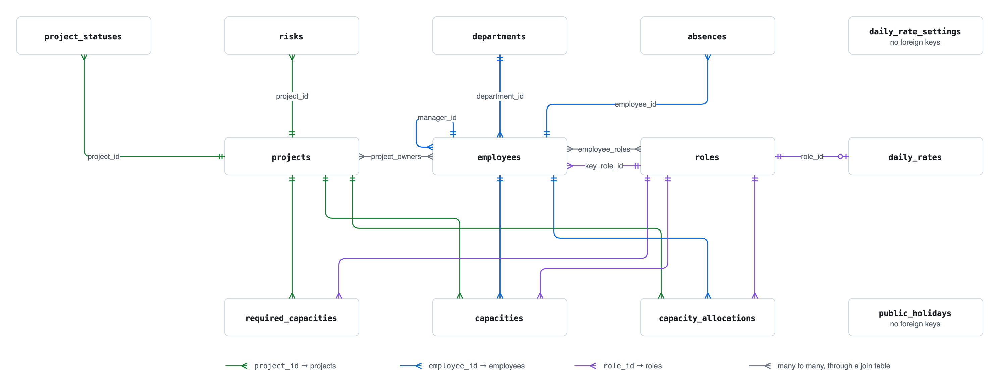

# Data model

Alloq stores its data in PostgreSQL. The tables are mapped by SQLAlchemy entities
in
[`alloq_commons/entities/`](../../components/alloq-commons/src/alloq_commons/entities/__init__.py).
The package exports 13 entities. The schema itself is created by the hand-written
Alembic migrations in `alembic/versions/`, so a change to an entity always needs a
migration as well (see [layers](./layers.md#migration)).

Every entity inherits `Entity` from appkit-commons. `Entity` adds three columns that
the tables below do not repeat:

- `id`, integer primary key with autoincrement and an index.
- `created`, timestamp with time zone, set by the database on insert.
- `updated`, timestamp with time zone, set on insert and on every update.

The same database also holds the appkit-user tables (`auth_users`,
`auth_sessions`, `auth_oauth_accounts`, `auth_oauth_states` and others). They
belong to appkit-user and are not described here. Alloq stores its app roles
`project_manager` and `employee` in the roles list of the appkit user, not in the
`roles` table below. See [security and access](./security-and-access.md).

## Entity relationship diagram

[Editable source: data-model.drawio](https://github.com/jenreh/alloq/blob/main/docs/diagrams/data-model.drawio)

The diagram shows the relations only. The fields are in the tables below.
`daily_rate_settings` and `public_holidays` have no foreign keys.

## How the planning data fits together

Three tables describe the staffing of a project. They answer different questions.

- `required_capacities` says how many person days of a role a project needs in
  total. It is meant to hold one row per project and role, but no unique
  constraint in the database enforces this.
- `capacity_allocations` is the weekly plan. One row holds the person days of one
  employee, in one role, on one project, in one week (`week_start`). The planning
  grid reads and writes this table.
- `capacities` is an assignment of an employee to a project and role for a date
  range with hours per week.

How the services use these tables is described on the
[calculations page](./calculations.md).

## Entities

### DepartmentEntity

Table `departments`. A department of the organization. An employee belongs to at
most one department.
[`department.py`](../../components/alloq-commons/src/alloq_commons/entities/department.py)

| Field | Type | Rules |
| --- | --- | --- |
| `name` | `String(255)` | not null, unique, index |
| `abbreviation` | `String(10)` | not null, unique |

### RoleEntity

Table `roles`. An organizational role that employees fill, e.g. a developer role.
This is not a permission role.
[`role.py`](../../components/alloq-commons/src/alloq_commons/entities/role.py)

| Field | Type | Rules |
| --- | --- | --- |
| `name` | `String(255)` | not null, unique, index |
| `abbreviation` | `String(3)` | not null, default `""` |
| `description` | `String(1000)` | nullable |
| `ramp_up` | `Boolean` | not null, default `False` |
| `ramp_down` | `Boolean` | not null, default `False` |

### EmployeeEntity

Table `employees`. A team member who can be planned.
[`employee.py`](../../components/alloq-commons/src/alloq_commons/entities/employee.py)

| Field | Type | Rules |
| --- | --- | --- |
| `first_name` | `String(255)` | not null, index |
| `last_name` | `String(255)` | not null, index |
| `seniority` | `String(50)` | not null; values from `SeniorityLevel` |
| `job_title` | `String(255)` | nullable |
| `email` | `String(255)` | nullable, unique |
| `location` | `String(255)` | nullable |
| `department_id` | FK `departments.id` | nullable, `ON DELETE SET NULL` |
| `hours_per_week` | `Float` | not null, default `40.0` |
| `internal_hours` | `Integer` | not null, default `4` |
| `manager_id` | FK `employees.id` | nullable, `ON DELETE SET NULL` |
| `key_role_id` | FK `roles.id` | nullable, `ON DELETE SET NULL` |

Relations:

- `roles`: many to many with `RoleEntity` through the table `employee_roles`
  (`employee_id`, `role_id`, both with `ON DELETE CASCADE`). The list holds all
  roles the employee can fill, including the key role.
- `department`: the `DepartmentEntity`.
- `absences`: the `AbsenceEntity` rows, with `cascade="all, delete-orphan"`.
- `manager`: another `EmployeeEntity`, with the back reference `direct_reports`.

`SeniorityLevel` has the values "Advanced", "Senior", "Professional" and "Expert".

`to_dict(absences_since=None)` drops absences that end before `absences_since`.
The default is today. It also puts the key role first, so `role_names[0]` is the
main role of the employee.

### AbsenceEntity

Table `absences`. A period in which an employee is absent.
[`absence.py`](../../components/alloq-commons/src/alloq_commons/entities/absence.py)

| Field | Type | Rules |
| --- | --- | --- |
| `employee_id` | FK `employees.id` | not null, index, `ON DELETE CASCADE` |
| `start_date` | `Date` | not null |
| `end_date` | `Date` | not null |

Check constraint `ck_absences_date_range`: `end_date >= start_date`.

### ProjectEntity

Table `projects`. A project that needs staff.
[`project.py`](../../components/alloq-commons/src/alloq_commons/entities/project.py)

| Field | Type | Rules |
| --- | --- | --- |
| `code` | `String(50)` | not null, unique, index |
| `customer` | `String(255)` | nullable, default `""` |
| `name_de` | `String(255)` | not null |
| `start_date` | `Date` | not null |
| `end_date` | `Date` | not null |
| `state` | `String(20)` | not null, default "Geplant"; values from `ProjectStateEnum` |
| `budget` | `Integer` | not null |
| `color` | `String(7)` | not null, default `#FFD43B` |
| `is_internal` | `Boolean` | not null, default `False` |
| `booking_number` | `String(50)` | nullable, default `""` |
| `ev_earned_value` | `Float` | nullable |
| `ev_actual_cost` | `Float` | nullable |
| `ev_eac_linear` | `Float` | nullable |
| `ev_eac_additive` | `Float` | nullable |

Check constraint `ck_projects_date_range`: `end_date >= start_date`.

`ProjectStateEnum` has the values "Geplant" [planned], "Aktiv" [active], "Risiko"
[at risk] and "Abgeschlossen" [completed].

Relations:

- `owners`: many to many with `EmployeeEntity` through the table `project_owners`
  (`project_id`, `employee_id`, both with `ON DELETE CASCADE`).
- `statuses`, `risks`, `capacities`, `capacity_allocations` and
  `required_capacities`: child rows with `cascade="all, delete-orphan"`. Deleting a
  project deletes them. `statuses` is ordered by `status_date`, newest first.

`to_dict()` adds values that are calculated from the child rows:

- `current_progress` and `current_spent` come from the newest status, or `0`.
- `team_initials` and `team_members` list the employees with person days above 0
  in weeks between the start week and the end week of the project
  (`_staffed_employee_capacity`).
- `risk_count` is the number of risks.

### ProjectStatusEntity

Table `project_statuses`. A status report of a project on one date.
[`status.py`](../../components/alloq-commons/src/alloq_commons/entities/status.py)

| Field | Type | Rules |
| --- | --- | --- |
| `project_id` | FK `projects.id` | not null, index, `ON DELETE CASCADE` |
| `status_date` | `Date` | not null, index |
| `progress` | `Integer` | not null, default `0` |
| `budget_spent` | `Integer` | not null, default `0` |
| `notes` | `String(2000)` | nullable |
| `budget` | `Float` | nullable |
| `earned_value` | `Float` | nullable |
| `actual_cost` | `Float` | nullable |
| `eac_linear` | `Float` | nullable |
| `eac_additive` | `Float` | nullable |

Check constraints:

- `ck_project_statuses_progress_range`: `progress` from 0 to 100.
- `ck_project_statuses_budget_spent_range`: `budget_spent` from 0 to 100.

### RiskEntity

Table `risks`. A risk of a project.
[`risk.py`](../../components/alloq-commons/src/alloq_commons/entities/risk.py)

| Field | Type | Rules |
| --- | --- | --- |
| `project_id` | FK `projects.id` | not null, index, `ON DELETE CASCADE` |
| `name` | `String(255)` | not null |
| `description` | `String(2000)` | nullable |
| `probability` | `Integer` | not null, default `3` |
| `impact` | `Integer` | not null, default `0` |
| `mitigation_status` | `String(30)` | not null, default `open` |
| `measures` | `String(2000)` | nullable |

`RiskMitigationStatus` has the values `open`, `mitigated` and `resolved`.
`MITIGATION_STATUS_LABELS` maps them to "Offen" [open], "In Bearbeitung" [in
progress] and "Geschlossen" [closed]. The module also defines
`HIGH_RISK_SCORE_THRESHOLD = 16`, the lowest score (probability times impact) for a
risk to appear on the dashboard.

The database allows any integer for `probability` and `impact`. The write model
`RiskCreate` in `alloq_commons/models/project.py` limits both to 1 to 5.

### RequiredCapacityEntity

Table `required_capacities`. The total person days of a role that a project needs.
[`required_capacity.py`](../../components/alloq-commons/src/alloq_commons/entities/required_capacity.py)

| Field | Type | Rules |
| --- | --- | --- |
| `project_id` | FK `projects.id` | not null, index, `ON DELETE CASCADE` |
| `role_id` | FK `roles.id` | not null, index, `ON DELETE RESTRICT` |
| `person_days` | `Integer` | not null |

Check constraint `ck_required_capacities_pd`: `person_days >= 0`.

### CapacityEntity

Table `capacities`. An assignment of an employee to a project in one role, for a
date range.
[`capacity.py`](../../components/alloq-commons/src/alloq_commons/entities/capacity.py)

| Field | Type | Rules |
| --- | --- | --- |
| `project_id` | FK `projects.id` | not null, index, `ON DELETE CASCADE` |
| `employee_id` | FK `employees.id` | not null, index, `ON DELETE CASCADE` |
| `role_id` | FK `roles.id` | not null, index, `ON DELETE RESTRICT` |
| `start_date` | `Date` | not null |
| `end_date` | `Date` | not null |
| `hours_per_week` | `Float` | not null, default `40.0` |

Constraints:

- `ck_capacities_date_range`: `end_date >= start_date`.
- `uq_capacities_proj_emp_role`: one row per project, employee and role.

### CapacityAllocationEntity

Table `capacity_allocations`. The person days of one employee on one project in one
role for one week.
[`capacity_allocation.py`](../../components/alloq-commons/src/alloq_commons/entities/capacity_allocation.py)

| Field | Type | Rules |
| --- | --- | --- |
| `project_id` | FK `projects.id` | not null, index, `ON DELETE CASCADE` |
| `employee_id` | FK `employees.id` | not null, index, `ON DELETE CASCADE` |
| `role_id` | FK `roles.id` | not null, index, `ON DELETE RESTRICT` |
| `week_start` | `Date` | not null, index |
| `person_days` | `Float` | not null, default `0.0` |

Constraints:

- `uq_capacity_alloc_proj_emp_role_week`: one row per project, employee, role and
  week.
- `ck_capacity_allocations_person_days`: `person_days >= 0`.

The relation to the project uses `lazy="raise_on_sql"`. The comment in the code
says that loading a week range must not pull every project with its whole
allocation history.

### DailyRateEntity

Table `daily_rates`. The daily rate of a role. An empty price means "not set".
[`daily_rate.py`](../../components/alloq-commons/src/alloq_commons/entities/daily_rate.py)

| Field | Type | Rules |
| --- | --- | --- |
| `role_id` | FK `roles.id` | not null, unique, `ON DELETE CASCADE` |
| `production_cost` | `Integer` | nullable |
| `list_price` | `Integer` | nullable; a manual list price, empty means it is calculated |

### DailyRateSettingsEntity

Table `daily_rate_settings`. Settings shared by all daily rates. The table holds a
single row.
[`daily_rate.py`](../../components/alloq-commons/src/alloq_commons/entities/daily_rate.py)

| Field | Type | Rules |
| --- | --- | --- |
| `min_contribution_margin_percent` | `Integer` | not null, default `30` (`DEFAULT_MIN_CONTRIBUTION_MARGIN_PERCENT`); the margin of the recommended sales price |
| `contribution_margin_percent` | `Integer` | not null, default `35` (`DEFAULT_CONTRIBUTION_MARGIN_PERCENT`); the margin of the list price |

No database constraint limits the table to one row. `DailyRateRepository` reads
the first row by `id` and creates it in `save_margins` when it is missing. When no
row exists, `get_margins` returns the two defaults.

### PublicHolidayEntity

Table `public_holidays`. A public holiday that reduces capacity.
[`public_holiday.py`](../../components/alloq-commons/src/alloq_commons/entities/public_holiday.py)

| Field | Type | Rules |
| --- | --- | --- |
| `name` | `String(255)` | not null, index |
| `date` | `Date` | not null, index |
| `is_recurring` | `Boolean` | not null, default `False` |
| `state_code` | `String(10)` | not null, default `NRW`, index |

A recurring holiday is stored once. `find_by_date_range` in
`public_holiday_repository.py` adds a copy for every year of the asked range with
the same month and day. It skips a date when a holiday with the same date and state
code is already in the range. The migration `2026_05_11_public_holidays.py` seeds
holidays for NRW.

## Open questions

- The appkit-user tables `auth_password_reset_tokens`, `auth_password_history` and
  `auth_password_reset_requests` are defined in appkit-user, but no migration in
  `alembic/versions/` creates them. It is not checked here whether password reset
  works on a database that was set up only by the migrations.
- The default `impact = 0` in `RiskEntity` is outside the range 1 to 5 of
  `RiskCreate`. It is not clear whether rows with impact 0 can exist.
