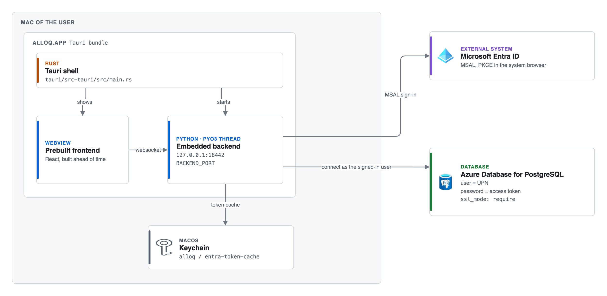
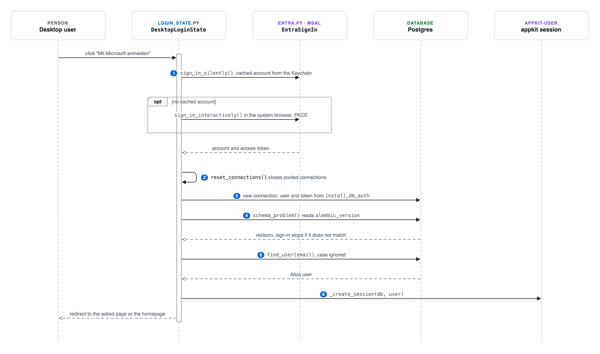

# Desktop app

The desktop app is a Tauri app for macOS with the Python backend built in. It uses
the library reflex-desktop. It uses the same central Postgres database as the web
app, and it carries no secrets. Each person signs in with Microsoft Entra ID and
connects to Postgres with their own access token.

This page is the English version of [`spec/desktop.md`](../../spec/desktop.md),
checked against `app/desktop/`, `tauri/` and `scripts/desktop.py`. Where the two
differ, this page follows the code.

## How the app runs



[Editable source: desktop-architecture.drawio](https://github.com/jenreh/alloq/blob/main/docs/diagrams/desktop-architecture.drawio)

- [`main.rs`](../../tauri/src-tauri/src/main.rs) starts the Python ASGI backend
  inside the app process through PyO3, on a background thread bound to
  `127.0.0.1:18442` (`BACKEND_PORT`). The webview shows the prebuilt frontend and
  talks to that backend.
- The bundle contains a Python interpreter (`python/`), the packages
  (`site-packages/`) and the app payload (`app/`). They are listed under
  `bundle.resources` in [`tauri.conf.json`](../../tauri/src-tauri/tauri.conf.json).
- `rxconfig.py` adds the `DesktopPlugin` from reflex-desktop only when
  `is_desktop()` is true (`desktop_plugins`). Inside the bundle, `cors_origins`
  allows only the webview origins `tauri://localhost`, `http://tauri.localhost`
  and `http://127.0.0.1:18442` to open the event socket.
- The window is 1440 by 900 pixels, at least 1100 by 700, with the title bar style
  `Overlay`. The sidebar of the app shell leaves its top row free for the window
  buttons.

### When the app counts as desktop

[`is_desktop()`](../../components/alloq-commons/src/alloq_commons/desktop.py)
returns true when `ALLOQ_DESKTOP=1` is set or when `REFLEX_DESKTOP_APP_ROOT` is
set. The Tauri host sets the second variable in the bundle.

[`activate_desktop_profile`](../../app/desktop/profile.py) runs in
`app/__init__.py` before the configuration is loaded. It adds the profile
`desktop` last to `PROFILES`, so it overrides every server value. When
`ALLOQ_FAKE_ENTRA_EMAIL` is set and the app does not run in the bundle, it also
adds `desktop_fake`.

### The desktop profile

[`configuration/config.desktop.yaml`](../../configuration/config.desktop.yaml)
sets:

- `backend_port: 18442`, which must match `BACKEND_PORT` in `main.rs`, and
  `workers: 1`.
- A database with an empty `username` and `password`, because both come from the
  Entra sign-in. `ssl_mode: require`, `pool_size: 2`, `max_overflow: 3`.
- An empty `encryption_key`. The comment says that only the stored OAuth tokens of
  appkit are encrypted and the desktop app never touches them.
- `oauth_providers: []`. The web OAuth flows need client secrets, and the desktop
  app has its own sign-in.
- `app.desktop` with `tenant_id`, `client_id` and `db_role` (see
  [`DesktopConfig`](../../app/desktop/config.py)).

Desktop variants in the UI:

- The login page shows only "Mit Microsoft anmelden" [sign in with Microsoft]
  (`_desktop_sign_in` in [`app/pages/login.py`](../../app/pages/login.py)).
- Every page shows a splash screen until its `on_load` handlers are done
  (`SplashState.finish` in
  [`splash.py`](../../components/alloq-commons/src/alloq_commons/components/splash.py)).
- The sidebar uses `DesktopLoginState.sign_out` to sign out.
- The users page shows the database access button (see below).

## Sign-in flow



[Editable source: desktop-sign-in-sequence.drawio](https://github.com/jenreh/alloq/blob/main/docs/diagrams/desktop-sign-in-sequence.drawio)

The steps in [`login_state.py`](../../app/desktop/login_state.py)
(`DesktopLoginState.sign_in_with_microsoft`, a background handler):

1. `microsoft_account` first tries the cached account from the macOS Keychain
   (service `alloq`, account `entra-token-cache`). When there is none, MSAL opens
   the sign-in in the default browser. This is the authorization code flow with
   PKCE and a redirect to `http://localhost`. The browser sign-in may take up to
   `sign_in_timeout` seconds, 300 by default.
2. `reset_connections` closes all pooled connections, because they carry the
   identity of the previous user.
3. Every new database connection gets the user and token of the signed-in person.
   `install_db_auth` in [`entra.py`](../../app/desktop/entra.py) registers a
   SQLAlchemy `do_connect` listener that calls `connect_params`. The user is
   `db_role` when it is set, otherwise the email from the token. The password is
   the access token. Before sign-in there is no connection, because
   `connect_params` raises `NotSignedInError`. `app/app.py` installs this listener
   only when `is_desktop()` is true and the sign-in is an `EntraSignIn`.
4. `allowed_user` checks the schema version with `schema_problem`. When it does not
   match, sign-in stops with a message. Migrations run only on the server.
5. `allowed_user` finds the Alloq user with the same email, without regard to case
   (`find_user`). The desktop app does not create users. An unknown email gives
   the message in `NO_ACCOUNT`, e.g. "Für {email} gibt es kein alloq-Konto. ..."
   [there is no alloq account for this email]. An inactive or not verified account
   gives the matching text from `STATUS_MESSAGES`.
6. The handler opens the normal appkit session with `_create_session` and redirects
   to the page the user asked for, or to the homepage.

There is no password login in the desktop app. The docstring of `login_state.py`
gives the reason: without a signed-in Microsoft account the app has no database
access to check a password against.

### Token renewal and restart

- `EntraSignIn` keeps the access token with its expiry. A background thread renews
  it `REFRESH_MARGIN` (300) seconds before it expires. When renewal fails, it tries
  again after `RETRY_SECONDS` (60) seconds.
- `access_token()` never hands out a token that expires within `EXPIRY_SLACK` (60)
  seconds.
- After a restart, `restore()` brings back the Microsoft account from the Keychain
  without a browser, as soon as a connection needs it. It tries at most every
  `RESTORE_INTERVAL` (30) seconds. When the Alloq session is still valid, the user
  goes on without the login page.

### Sign-out

"Abmelden" [sign out] calls `DesktopLoginState.sign_out`. It ends the appkit
session (`logout`), removes the Microsoft account from the token cache on this Mac
(`EntraSignIn.sign_out`) and closes all database connections
(`reset_connections`).

## Schema check

[`app/desktop/schema.py`](../../app/desktop/schema.py) holds `KNOWN_REVISIONS`, the
Alembic history newest first. `EXPECTED_REVISION` is the first entry.
`schema_problem` reads `alembic_version` and returns:

- `None` when the database has the expected revision.
- A message that the server migration is still missing, when the revision is an
  older known one.
- A message to update the app, when the revision is unknown or empty.

After every new migration, add its revision at the front of `KNOWN_REVISIONS`. The
test `test_known_revisions_are_the_alembic_history` in
[`tests/test_desktop_login.py`](../../tests/test_desktop_login.py) fails until you
do.

## Database access for desktop users

### Database role

The migration
[`2026_10_15_desktop_database_role.py`](../../alembic/versions/2026_10_15_desktop_database_role.py)
(revision `ee66ff77aa88`) creates the role `<database>_app`, which is `alloq_app`
in production. The role may read and change every table and sequence, including
the ones of later migrations, but it may not change the schema. On databases other
than PostgreSQL the migration does nothing.

### Setup in Azure, done once

App registration. The values are in `app.desktop` of `config.desktop.yaml`. They
point to the entries of the web app with `secret:`. At build time,
`scripts/desktop.py` resolves them and writes the plain values into the app. This
is only allowed for the public identifiers in `BUILD_TIME_KEYS`: `tenant_id`,
`client_id`, `host` and `name`. Any other `secret:` stops the build with a
`BuildError`. The registration needs these settings:

- The platform "Mobile and desktop applications" with the redirect URI
  `http://localhost`.
- "Allow public client flows" set to yes. The desktop app sends no client secret.
- The delegated API permission "Azure OSSRDBMS Database" with
  `user_impersonation`, with admin consent. The scope in the code is
  `https://ossrdbms-aad.database.windows.net/.default` (`POSTGRES_SCOPE`).

When the web app and the desktop app share one registration, these settings come
in addition to the web platform.

Postgres (Azure Database for PostgreSQL, Flexible Server):

1. Turn on Microsoft Entra authentication and set the first person as Entra admin
   (type "User", their UPN). This person is the database admin and signs in with
   their own account like everyone else. `db_role` stays empty.
2. Run the migrations. The migration `ee66ff77aa88` creates `alloq_app`. Then the
   creator of the role grants it once with `ADMIN OPTION` to the Entra admin
   principal, e.g. `GRANT alloq_app TO "admin@example.com" WITH ADMIN OPTION;`.
   Do not change the protected Azure role `azure_pg_admin`. Further database admins
   get the same grant. Normal desktop users get the role without `ADMIN OPTION`.
3. Give access in the desktop app, as described in the next section.
4. The server must be reachable from the Macs, e.g. over VPN or a firewall rule.
   TLS is required (`ssl_mode: require`).

### Granting access in the app

On the users page `/admin/users`, the desktop app adds a database button to every
row (`row_actions` in [`app/pages/users.py`](../../app/pages/users.py)). The button
is in [`db_access_button.py`](../../app/components/db_access_button.py). It is green
when the user has access and gray when not.

[`DatabaseAccessState`](../../app/desktop/db_access_state.py) is an admin state:

- `load` (`@requires_admin`) does nothing outside the desktop app. In the desktop
  app it reads the overview from `DatabaseAccess.overview()`.
- `toggle` (`@requires_admin`) grants or revokes the role for one email. It shows
  the toast "Datenbankzugriff für {email} vergeben." [access granted] or
  "... entzogen." [revoked].
- `can_manage` is true only when the signed-in database login holds the role with
  `ADMIN OPTION`. Without it the button only shows the access (`locked`).

[`DatabaseAccess`](../../app/desktop/db_access.py) does the work:

- `grant` looks up the existing Postgres principal for the email. An exact match
  wins over a match that ignores case. When there is none, it creates the Entra
  principal with `pgaadauth_create_principal` in the database `postgres`. That
  needs Entra admin rights. It then runs `GRANT <role> TO <principal>`.
- `revoke` runs `REVOKE <role> FROM <principal>`, or does nothing when no principal
  exists.
- Both raise `DatabaseAccessError` with the text `NOT_ADMIN` when the signed-in
  login may not manage the role.
- Role names are quoted with `quote_identifier`, which rejects a NUL character.

The email in Alloq must match the Microsoft sign-in name (UPN), because Postgres
signs the person in with that name. A person with database rights can also use
their token to reach the database directly, past the admin checks of the app. Give
the role only to people who are admins in Alloq.

## Build and run

The tasks are in
[`taskfiles/Taskfile.reflex.yml`](../../taskfiles/Taskfile.reflex.yml). They need
Rust and the Xcode command line tools. `--bundle` also needs `cargo-tauri`.

| Task | What it does |
| --- | --- |
| `task desktop:doctor` | Checks the native toolchain |
| `task desktop:dev` | Starts the app with hot reload and the fake sign-in against the local database |
| `task desktop:run` | Builds a debug app and opens the window |
| `task desktop:build` | Builds the release app and the macOS installer (`.dmg`) |
| `task desktop:requirements` | Writes `requirements.txt` for the embedded runtime from `uv.lock` |
| `task desktop:clean` | Removes the Tauri build output |

[`scripts/desktop.py`](../../scripts/desktop.py) wraps the reflex-desktop CLI:

- It bundles Python 3.14 and drops an extracted runtime of another version.
- It copies only `config.yaml`, `config.desktop.yaml` and `logging.yaml` into the
  payload (`CONFIG_FILES`). Server profiles, `.env` and `desktop_fake` stay out.
- `dev` uses a separate shell in `tauri-dev/`. `sync_dev_shell` copies the shared
  parts of `tauri/` into it on every start, e.g. the version, the window settings
  and the native menu.

### Testing without Microsoft sign-in

`task desktop:dev` sets `ALLOQ_FAKE_ENTRA_EMAIL` to `admin@aila-solutions.com` by
default. To sign in as another user, run
`ALLOQ_FAKE_ENTRA_EMAIL=<email> task desktop:dev`. Without the task:

```bash
ALLOQ_DESKTOP=1 ALLOQ_FAKE_ENTRA_EMAIL=admin@aila-solutions.com uv run reflex run
```

With the variable set, [`fake.py`](../../app/desktop/fake.py) replaces MSAL with
`FakeEntraSignIn`:

- "Mit Microsoft anmelden" signs in as this Alloq user without a browser.
- The database uses the local credentials of the profile `desktop_fake`
  ([`config.desktop_fake.yaml`](../../configuration/config.desktop_fake.yaml)),
  with `ssl_mode: disable` and the frontend on port 18443.
- A schema mismatch only logs a warning.
- Inside the app bundle `fake_email()` ignores the variable, and the build never
  ships `desktop_fake`.

When the normal development server runs at the same time, set
`REFLEX_WEB_WORKDIR=<other folder>` so the desktop app uses its own `.web` folder. Reflex reads this variable in `reflex/utils/prerequisites.py`.

Tests: [`test_desktop_entra.py`](../../tests/test_desktop_entra.py),
[`test_desktop_login.py`](../../tests/test_desktop_login.py),
[`test_desktop_db_access.py`](../../tests/test_desktop_db_access.py) and
[`test_desktop_fake.py`](../../tests/test_desktop_fake.py).

The stories for the desktop app are on the [story map](../features/story-map.md).

## Open questions

- `spec/desktop.md` contains its whole text twice. The two copies differ in step 2
  of the Postgres setup. The first copy says to grant `alloq_app` with
  `ADMIN OPTION` to the Entra admin. The second copy says the database admins
  (`azure_pg_admin`) may pass the role on. The migration docstring and `README.md`
  match the first copy, so this page follows it.
- `tauri.conf.json` and `Cargo.toml` in `tauri/src-tauri/` carry the version
  `0.4.4`, while the app is `2.0.4`. It is not checked here whether the build
  script sets the bundle version from somewhere else.
- The comment in `config.desktop.yaml` says that `rxconfig.py` adds the desktop
  profile. In the code, `activate_desktop_profile` in `app/desktop/profile.py` does
  it, called from `app/__init__.py`.
