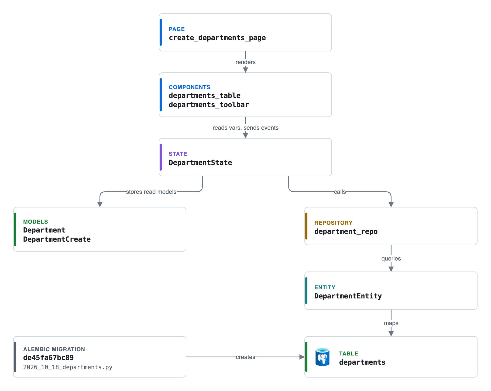

# Layers

Every feature in Alloq is built from the same layers. This page explains each layer
and shows it on one feature, the departments page at `/admin/departments`
("Abteilungen" [departments]). The departments slice is small and touches every
layer, so it is a good model when you add a new feature.

Paths below are relative to this page. `commons` means
`components/alloq-commons/src/alloq_commons`.

| Layer | What it does | Departments file |
| --- | --- | --- |
| Entity | SQLAlchemy table mapping | [`entities/department.py`](../../components/alloq-commons/src/alloq_commons/entities/department.py) |
| Model | Pydantic read model and write model | [`models/department.py`](../../components/alloq-commons/src/alloq_commons/models/department.py) |
| Repository | Database queries for one entity | [`repositories/department_repository.py`](../../components/alloq-commons/src/alloq_commons/repositories/department_repository.py) |
| Service | Calculations without UI (none for departments) | see [Service](#service) |
| State | Reflex state with guarded event handlers | [`state/department_states.py`](../../components/alloq-commons/src/alloq_commons/state/department_states.py) |
| Component | UI built from `appkit_mantine` | [`components/department.py`](../../components/alloq-commons/src/alloq_commons/components/department.py) |
| Page | Page factory with route, toolbar and `on_load` | [`app/pages/departments.py`](../../app/pages/departments.py) |
| Registration | Page factory call and sidebar entry | [`app/app.py`](../../app/app.py), [`app/components/sidebar.py`](../../app/components/sidebar.py) |
| Migration | Hand-written Alembic file | [`2026_10_18_departments.py`](../../alembic/versions/2026_10_18_departments.py) |
| Tests | State, model and component tests | [`test_departments.py`](../../components/alloq-commons/tests/test_departments.py) |

[Editable source: layers-department.drawio](https://github.com/jenreh/alloq/blob/main/docs/diagrams/layers-department.drawio)

## Entity

An entity maps one table. Entities live in `commons/entities/` and are exported
from `commons/entities/__init__.py`.

`DepartmentEntity` maps the table `departments`. It inherits `Entity` and `Base`
from `appkit_commons.database.entities`. `Entity` adds three columns to every table:

- `id`, an integer primary key with autoincrement.
- `created`, a timestamp with time zone, set by the database (`server_default`).
- `updated`, a timestamp with time zone, set on insert and on every update.

The department adds two columns:

- `name`, `String(255)`, unique, not null, with an index.
- `abbreviation`, `String(10)`, unique, not null.

Every entity has a `to_dict()` method. The state passes its result to the Pydantic
read model, so `to_dict()` must contain every field the read model needs.

All entities are listed on the [data model page](./data-model.md).

## Model

Models are Pydantic classes in `commons/models/`. A model module usually has two
classes:

- A **read model** with defaults for every field. `Department` has `id = 0`,
  `name = ""`, `abbreviation = ""`, `created` and `updated`. The read model is what
  a state stores in its vars and what the components render. `Department` also has
  a `label` property that returns the name with the abbreviation in brackets, e.g.
  "Informationstechnik (IT)".
- A **write model** that checks input. `DepartmentCreate` requires `name` with
  `min_length=1, max_length=255` and `abbreviation` with
  `min_length=1, max_length=10`. The state builds it from the form data and turns a
  `ValidationError` into a toast.

## Repository

A repository holds the queries for one entity. Repositories live in
`commons/repositories/`. Each module ends with a singleton, e.g.
`department_repo = DepartmentRepository()`, and the package `__init__.py` exports
both the class and the singleton.

`DepartmentRepository` extends `BaseRepository[DepartmentEntity, AsyncSession]` from
appkit-commons. The base class gives `create`, `update`, `save`, `find_by_id`,
`find_all`, `count`, `delete_by_id` and more. The department repository only adds
`find_all_paginated(session, limit=200, offset=0)`, ordered by name.

A repository does not commit. `BaseRepository` only flushes. The commit happens
when the `async with get_asyncdb_session() as session:` block ends without an
error. On an error the session manager rolls back.

## Service

A service is plain Python that calculates something. It does not render UI and
does not depend on Reflex state, so it can be tested without a browser. Departments
have no service, because they are simple create, read, update and delete.

The code keeps loading apart from calculation. These are three examples:

- [`daily_rate_pricing.py`](../../components/alloq-commons/src/alloq_commons/services/daily_rate_pricing.py)
  has only pure functions, e.g. `price_for_margin` and `round_up_to_ten`.
- [`team_overview.py`](../../components/alloq-team/src/alloq_team/services/team_overview.py)
  has `load_inputs` to read the database and `build_overview` to calculate.
- [`portfolio_inputs.py`](../../components/alloq-dashboard/src/alloq_dashboard/services/portfolio_inputs.py)
  loads rows with `load_inputs`, and
  [`portfolio.py`](../../components/alloq-dashboard/src/alloq_dashboard/services/portfolio.py)
  calculates from them.

The [calculations page](./calculations.md) describes the main services.

## State

A state is a Reflex `rx.State` class. Its vars are sent to the browser, and its
event handlers run in the backend when the browser sends an event.

[`department_states.py`](../../components/alloq-commons/src/alloq_commons/state/department_states.py)
shows the usual parts:

- A module-level loader `load_departments()` opens a session, calls
  `department_repo.find_all_paginated` and returns a list of `Department` read
  models. Handlers and tests both use it.
- `DepartmentState` holds the vars: `departments`, `selected_department`,
  `is_loading`, `add_modal_open`, `edit_modal_open` and `search_filter`.
- A computed var `filtered_departments` (`@rx.var`) filters by the search text. It
  matches the name or the abbreviation, without regard to case.
- Handlers that only change UI state have no guard, e.g. `set_search_filter`,
  `open_add_modal`, `close_add_modal` and `close_edit_modal`. They are listed in
  `UI_ONLY_HANDLERS` in `tests/test_handler_authorization.py`, and a test checks
  that they do not reach the database.
- Handlers that read or write data have a guard. All department handlers that touch
  the database use `@requires_admin`, because departments are administration.
  Planning packages use `@requires_editor` instead. See
  [security and access](./security-and-access.md).
- Errors become German toasts. `create_department` and `update_department` show
  "Name und Kürzel angeben." [enter name and abbreviation] on a `ValidationError`
  and "Name oder Kürzel ist bereits vergeben." [name or abbreviation is already
  taken] (`DUPLICATE_MESSAGE`) on an `IntegrityError`. Other errors are logged with
  `logger.exception` and shown as a general error toast.
- After a change, the handler loads the list again and shows an info toast, e.g.
  "Abteilung '...' wurde erstellt." [department was created].

`load_user_roles` connects departments to user management. It offers the app roles
from `ALL_ROLES` plus one permission role per department to `UserState`. The
department roles come from `department_roles` in
[`roles.py`](../../components/alloq-commons/src/alloq_commons/roles.py). Their name
is `department_<id>`, so a rename keeps the role. They sit in the group
"Abteilungen".

### Large states use mixins

`ProjectState`, `TeamState` and `PlanningStore` are large. Their list and UI logic
sits in mixins (`rx.State, mixin=True`) that the concrete state inherits. An example
is `TeamListState` in
[`team_list_state.py`](../../components/alloq-team/src/alloq_team/states/team_list_state.py),
which is mixed into `TeamState`. A mixin declares the vars of the parent state only
under `TYPE_CHECKING`, so Reflex does not create them twice.

### Background loads

The dashboard cards load in the background (`@rx.event(background=True)`). A guard
decorator cannot run there, so the plain Python mixin `_CardLoadMixin` in
[`dashboard_states.py`](../../components/alloq-dashboard/src/alloq_dashboard/states/dashboard_states.py)
checks the rights itself. `_run_card_load` takes the state lock with
`async with self:`, calls `_can_edit`, and only then calls the loader. A sequence
number `_load_seq` drops the result of a load that a newer load has replaced.

## Component

Components are Python functions that return `rx.Component`. They use
`appkit_mantine` (imported as `mn`) and read state vars.
[`components/department.py`](../../components/alloq-commons/src/alloq_commons/components/department.py)
has these parts:

- `department_form_fields(department=None)` builds the two inputs. The add dialog
  calls it without an argument and the edit dialog passes the selected department,
  so both dialogs share one form. The inputs set
  `custom_attrs={"maxLength": 255}` and `{"maxLength": 10}`, so the browser stops
  typing at the same limits as `DepartmentCreate`.
- `add_department_modal` and `edit_department_modal` submit to
  `DepartmentState.create_department` and `DepartmentState.update_department`.
- `departments_table` renders the rows with
  `rx.foreach(DepartmentState.filtered_departments, departments_table_row)`. While
  `is_loading` is true it shows "Lade Abteilungen..." [loading departments].
- Each row has an edit button and a `delete_dialog` with the title "Löschen
  bestätigen" [confirm delete].
- `departments_toolbar` returns a search field and the primary button "Neue
  Abteilung" [new department]. It uses `toolbar_search` and `primary_button` from
  `commons/components/toolbar.py`.

## Page

A page factory registers a route.
[`create_departments_page`](../../app/pages/departments.py) uses the `app_page`
decorator from `commons/components/shell.py` with these settings:

- `route="/admin/departments"` and `title="Abteilungen"`.
- `toolbar=window_toolbar(...)` with the subtitle "Administration · Abteilungen
  anlegen, bearbeiten und löschen" and the toolbar actions.
- `admin_only=True`, passed on to appkit's `authenticated_page`.
- `on_load=[DepartmentState.load_departments]`.

The page content is wrapped in `requires_admin(...)` from appkit-user, so only
admins see the table.

Admin pages live in `app/pages/`. Feature pages live in `alloq_<feature>/pages.py`,
e.g. `create_projects_overview_page` and `create_planning_page` in
[`alloq_project/pages.py`](../../components/alloq-project/src/alloq_project/pages.py).
Feature pages wrap their content in `viewer_only` or `editor_only` from
`access.py`, with `no_access()` as the fallback.

## Registration

Two places make a page reachable:

- [`app/app.py`](../../app/app.py) calls `create_departments_page(sidebar())`.
- [`app/components/sidebar.py`](../../app/components/sidebar.py) has the entry
  `("/admin/departments", "Abteilungen", "building-2")` in `ADMIN_ITEMS`.

When a package adds an entity, model or repository, it also exports it from the
`__init__.py` of `entities`, `models` or `repositories`. States import from the
package, e.g. `from alloq_commons.repositories import department_repo`.

## Migration

Migrations are written by hand in `alembic/versions/`. The project does not use
`--autogenerate`.
[`2026_10_18_departments.py`](../../alembic/versions/2026_10_18_departments.py)
(revision `de45fa67bc89`) shows the usual steps:

1. `op.create_table("departments", ...)` with a unique constraint
   `uq_departments_abbreviation` and a unique index `ix_departments_name`.
2. `op.batch_alter_table("employees")` adds `department_id` with a foreign key
   `fk_employees_department_id_departments` and `ondelete="SET NULL"`.
3. `op.execute(...)` moves the old free text column `employees.department` into
   the new table. It uses the first 10 characters as the abbreviation.
4. The old column `department` is dropped.
5. `downgrade()` undoes all of this and copies the abbreviation back into a
   `department` column.

Each new revision also goes first into `KNOWN_REVISIONS` in
[`app/desktop/schema.py`](../../app/desktop/schema.py). The test
`test_known_revisions_are_the_alembic_history` in `tests/test_desktop_login.py`
compares this tuple with the Alembic history and fails when they differ. The
desktop app uses the newest entry to check the database schema at sign-in.

## Tests

[`test_departments.py`](../../components/alloq-commons/tests/test_departments.py)
covers the slice without a database:

- The `repo` fixture patches `department_repo` and `get_asyncdb_session` in the
  state module (`MODULE = "alloq_commons.state.department_states"`).
- A helper `_as_admin` makes the guard see an admin user.
- Tests cover the model limits (`test_create_requires_name_and_short_abbreviation`),
  the search filter (`test_filter_matches_name_or_abbreviation`), create, update,
  delete, the duplicate message and the browser length limits
  (`test_form_inputs_limit_length_in_browser`).

On top of the slice tests, `tests/test_handler_authorization.py` checks every
handler of every state for a guard. More on tests is in the
[testing reference](../reference/testing.md).

The stories for the department page are on the [story map](../features/story-map.md).
