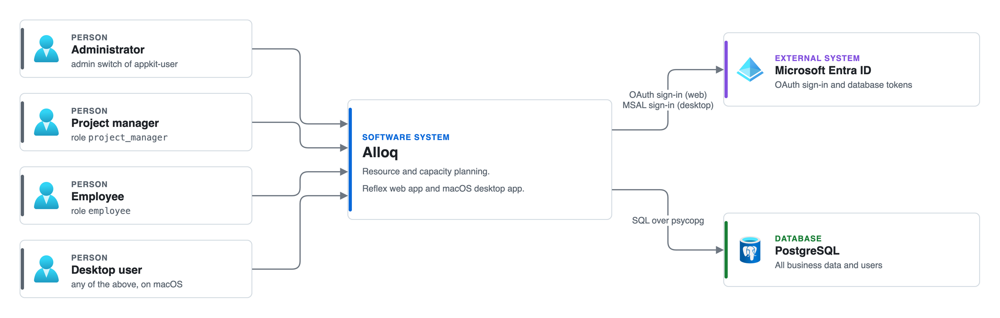
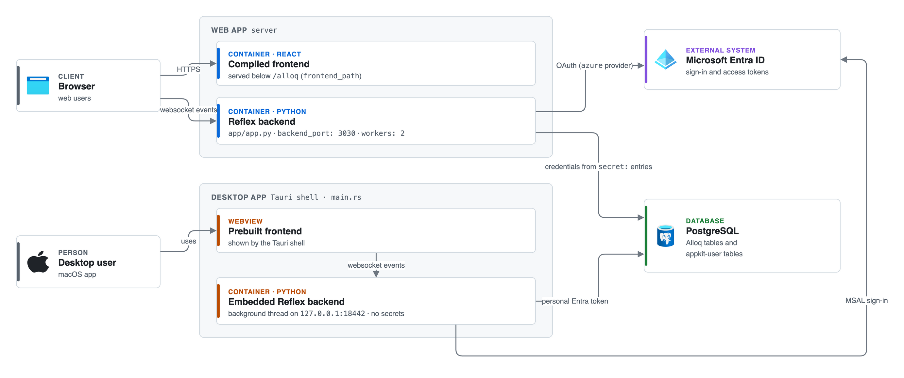
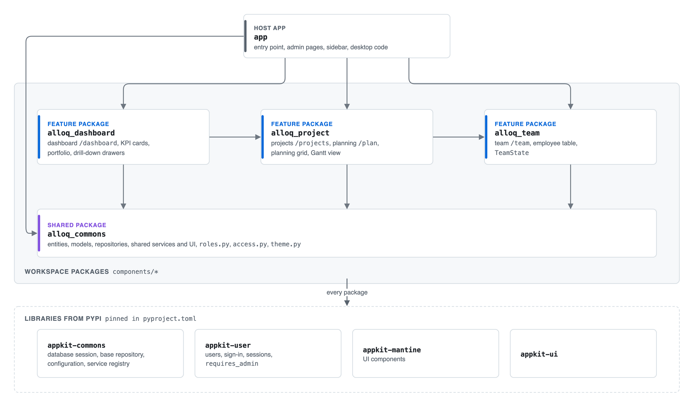
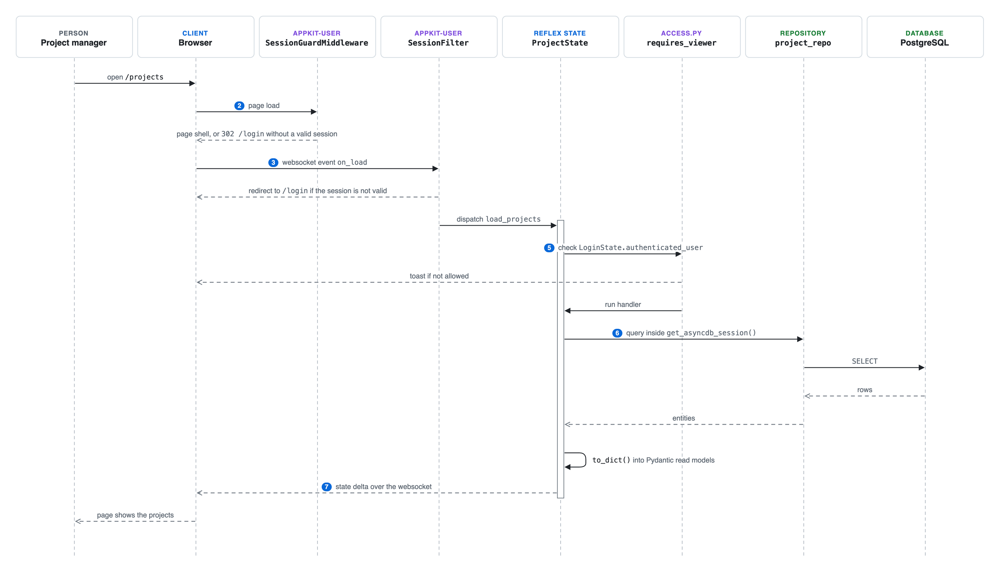

# Architecture overview

Alloq is a resource planning app for software teams. It is written in Python with
[Reflex](https://reflex.dev) 0.10.0, which builds a React frontend from Python code
and runs the event handlers in a Python backend. The data lives in PostgreSQL. The
same code runs as a web app and as a macOS desktop app.

This page describes the system from the outside in. It uses the C4 levels:

- **Context.** Who uses Alloq and which other systems it talks to.
- **Containers.** The programs that run and the data store.
- **Components.** The Python packages inside the app.

The last section follows one request from a page to the database. The
[layers page](./layers.md) then explains each layer in the code.

## System context

Four kinds of people use Alloq. The personas come from the roles in
[`roles.py`](../../components/alloq-commons/src/alloq_commons/roles.py)
(`PROJECT_MANAGER_ROLE`, `EMPLOYEE_ROLE`) and the admin switch of appkit-user.

- **Administrator.** An appkit user with the admin switch. Administrators can do
  everything, including the pages under "Administration".
- **Project manager.** A user with the role `project_manager` ("Projektmanager").
  Project managers read and edit planning, projects and team, but they have no
  administration.
- **Employee.** A user with the role `employee` ("Mitarbeiter" [employee]).
  Employees can only read the projects page and the resource planning.
- **Desktop user.** Any of the three above who uses the desktop app. The desktop
  user signs in with Microsoft Entra ID and connects to Postgres with a personal
  token.

[Editable source: system-context.drawio](https://github.com/jenreh/alloq/blob/main/docs/diagrams/system-context.drawio)

The base configuration
[`configuration/config.yaml`](../../configuration/config.yaml) lists one OAuth
provider, `azure`. A GitHub provider is in the file but commented out. The desktop
sign-in is described on the [desktop page](./desktop.md).

## Containers

Alloq has two ways to run the same Python code.

- **Web app.** The Reflex backend runs on a server (backend port `3030` in
  `config.yaml`, `workers: 2`). It serves the compiled frontend below the path
  `/alloq` (`frontend_path`). Users open it in a browser. The browser talks to the
  backend over a websocket. Every click that needs data sends an event over this
  websocket to a state class in the backend.
- **Desktop app.** A Tauri shell in [`tauri/`](../../tauri/src-tauri/src/main.rs)
  starts the same Python backend inside the app process. `main.rs` runs it on a
  background thread bound to `127.0.0.1:18442` (`BACKEND_PORT`) and shows the
  prebuilt frontend in a webview. The app carries no secrets. Each person signs in
  with Entra ID and connects to Postgres with their own token.
- **PostgreSQL.** One database holds the Alloq tables and the appkit-user tables.
  The web app connects with the credentials from the `secret:` entries in
  `config.yaml`. The desktop app connects with the Entra token of the signed-in
  person.

[Editable source: deployment-modes.drawio](https://github.com/jenreh/alloq/blob/main/docs/diagrams/deployment-modes.drawio)

The configuration profiles that select these modes are listed in the
[configuration reference](../reference/configuration.md).

## Components: the package split

The code is a uv workspace. The host app and four packages are members. The
workspace is declared in [`pyproject.toml`](../../pyproject.toml) under
`[tool.uv.workspace]` with `members = ["components/*"]`.

| Package | Path | What it holds |
| --- | --- | --- |
| Host app | [`app/`](../../app/app.py) | Entry point `app/app.py`, admin pages in `app/pages/`, the sidebar in `app/components/sidebar.py`, desktop code in `app/desktop/`, configuration in `app/configuration.py` |
| `alloq-commons` | [`components/alloq-commons`](../../components/alloq-commons/src/alloq_commons/__init__.py) | Entities, models, repositories, shared services (`utilization.py`, `quick_project.py`, `daily_rate_pricing.py`), shared UI (`shell.py`, `list_view.py`, `toolbar.py`, `excel_grid/`), `roles.py`, `access.py`, `theme.py`, and the department, role, daily rate and holiday states |
| `alloq-team` | [`components/alloq-team`](../../components/alloq-team/src/alloq_team/pages.py) | Team page (`/team`), employee table, cards, inspector and form, `TeamState` |
| `alloq-project` | [`components/alloq-project`](../../components/alloq-project/src/alloq_project/pages.py) | Projects page (`/projects`), planning page (`/` and `/plan`), planning grid, Gantt view, plan modal, forecast and plan distribution services |
| `alloq-dashboard` | [`components/alloq-dashboard`](../../components/alloq-dashboard/src/alloq_dashboard/pages.py) | Dashboard page (`/dashboard`), KPI cards, portfolio, drill-down drawers, aggregation services |

Each feature package has the same folders: `components/`, `services/`, `states/`
and a `pages.py` with a page factory. The host app calls every page factory once in
[`app/app.py`](../../app/app.py) and passes it the sidebar.

All packages also use the appkit libraries from PyPI: `appkit-commons` (database
session, base repository, configuration, service registry), `appkit-user` (users,
sign-in, sessions, `requires_admin`), `appkit-mantine` (UI components) and
`appkit-ui`. Their versions are pinned in `pyproject.toml`.

### Dependency direction

[Editable source: package-split.drawio](https://github.com/jenreh/alloq/blob/main/docs/diagrams/package-split.drawio)

The arrows point from the package that imports to the package it imports. These are
the rules:

- No package in `components/` may import the host app `app`. The test
  [`tests/test_component_boundaries.py`](../../tests/test_component_boundaries.py)
  (`test_components_do_not_import_host_app`) parses every `.py` file under
  `components/*/src/` and fails if it finds `import app` or `from app...`.
- The same test file checks that `app.roles.ALL_ROLES` is the same object as
  `alloq_commons.roles.ALL_ROLES` (`test_app_roles_reexports_commons_roles`). The
  host app re-exports the roles and does not define its own.
- `alloq_commons` imports no feature package. Its `pyproject.toml` lists no
  workspace dependencies.
- `alloq_team` depends only on `alloq_commons`
  ([`pyproject.toml`](../../components/alloq-team/pyproject.toml)).
- `alloq_project` depends on `alloq_commons` and `alloq_team`
  ([`pyproject.toml`](../../components/alloq-project/pyproject.toml)). The planning
  grid and Gantt view reuse the absence dialog `absence_modal` and `TeamState` from
  `alloq_team`, e.g. in
  [`planning_absence_state.py`](../../components/alloq-project/src/alloq_project/states/planning_absence_state.py).
- `alloq_dashboard` declares `alloq-project` and `alloq-team` in its
  [`pyproject.toml`](../../components/alloq-dashboard/pyproject.toml). In the code it
  imports `ProjectState` and `project_card` from `alloq_project`, e.g. in
  [`project_cards.py`](../../components/alloq-dashboard/src/alloq_dashboard/components/project_cards.py).

Only the first two rules have a test. The direction between the feature packages is kept
by the `pyproject.toml` dependencies and by review.

## Request flow from a page to the database

This example follows a project manager who opens the projects page `/projects`.

[Editable source: page-load-sequence.drawio](https://github.com/jenreh/alloq/blob/main/docs/diagrams/page-load-sequence.drawio)

The steps in the code:

1. **Page registration.** `create_projects_overview_page` in
   [`alloq_project/pages.py`](../../components/alloq-project/src/alloq_project/pages.py)
   uses `app_page` from
   [`shell.py`](../../components/alloq-commons/src/alloq_commons/components/shell.py).
   `app_page` registers the route through appkit's `authenticated_page`. It wraps
   the content in the app window (sidebar, toolbar, pane) and sets the `on_load`
   handlers. On the desktop, `desktop_handlers` adds `SplashState.finish` to the end
   of the list.
2. **Page load guard.** `app/app.py` passes `add_session_guard` to
   `rx.App(api_transformer=...)`. This appkit middleware redirects a page load
   without a valid session to `/login`. Its own docstring says it only sees page
   loads in the single port production setup.
3. **Event guard.** `install_session_filter(app)` adds appkit's `SessionFilter` to
   the websocket event stream. It stops events from users without a valid session
   before any `on_load` handler runs. Public routes are `/login`,
   `/password-reset`, `/password-reset/confirm` and `/oauth/*/callback` (the
   default `public_routes` of appkit-user).
4. **Page content guard.** The page content is wrapped in `viewer_only`,
   `editor_only` or `requires_admin`. These only decide what is rendered.
5. **Handler guard.** The handler itself carries a guard decorator from
   [`access.py`](../../components/alloq-commons/src/alloq_commons/access.py)
   (`requires_viewer`, `requires_editor`) or appkit's `requires_admin`. This is
   the check that protects the data, because a client can send events over the
   websocket without loading the page. See
   [security and access](./security-and-access.md).
6. **Data access.** The handler opens `get_asyncdb_session()` from appkit-commons,
   calls a repository singleton such as `project_repo`, and turns the entities
   into Pydantic read models with `to_dict()`.
7. **Response.** Reflex sends the changed state vars to the browser as a delta, and
   the components re-render.

A second middleware, `add_https_middleware` in `app/app.py`, wraps the backend in
`ForceHTTPSMiddleware`. It accepts `X-Forwarded-Proto` from the proxies listed in
`app.trusted_proxies`. It sets the scheme and does not redirect.

## Navigation

The sidebar in [`app/components/sidebar.py`](../../app/components/sidebar.py) has
two lists:

- `PLANNING_ITEMS`: "Übersicht" [overview] `/dashboard`, "Ressourcenplanung"
  [resource planning] `/plan`, "Projekte" [projects] `/projects`, "Team" `/team`.
- `ADMIN_ITEMS`: "Benutzer" [users], "Rollen" [roles], "Abteilungen" [departments],
  "Branchen" [industries], "Angebote" [offers: templates, chapter blocks and AI
  prompts], "Feiertage" [public holidays], all below `/admin/`.

`VIEWER_ROUTES` holds `/plan` and `/projects`, the two pages the employee role may
read. The route `/` shows the same planning page as `/plan`.

The features behind these pages are described as user stories on the
[story map](../features/story-map.md).

## Open questions

- `README.md` names Reflex 0.9.2 in the tech stack table, while `pyproject.toml`
  pins `reflex==0.10.0`. This page follows `pyproject.toml`.
- `app/app.py` imports `azure_oauth_callback_page` and `github_oauth_callback_page`
  only for their side effect of registering callback routes. The appkit-user module
  `authentication/pages.py` declares four callback pages with `@rx.page`
  (`/oauth/github/callback`, `/oauth/azure/callback`, `/oauth/google/callback`,
  `/oauth/apple/callback`), so the import registers all four. Only the `azure`
  provider is configured. It is open whether the unused callback routes should be
  documented as part of Alloq.
