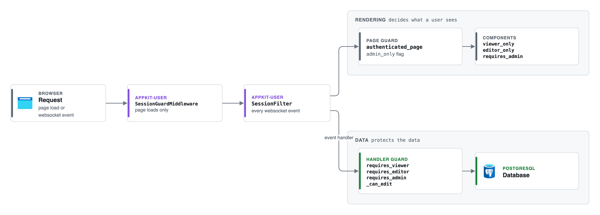

# Security and access

Alloq uses the library appkit-user for users, sign-in and sessions. Alloq adds its
own access levels on top. This page explains both parts and the tests that keep
them in place. The desktop sign-in with Entra ID is on the
[desktop page](./desktop.md).

## Overview

A request passes several checks. Each check has a different job.

[Editable source: request-guards.drawio](https://github.com/jenreh/alloq/blob/main/docs/diagrams/request-guards.drawio)

Only the handler guard protects the data. The other checks decide what a user sees
and send users without a session to the login page. The docstring of
[`tests/test_handler_authorization.py`](../../tests/test_handler_authorization.py)
states the reason: page guards only affect rendering, and event handlers run over
the websocket regardless.

## Sign-in

### Login page

[`create_login_page`](../../app/pages/login.py) registers the route `/login` with
the title "Anmelden" [sign in]. Its `on_load` runs
`LoginState.clear_session_storage_token`. On the desktop, `desktop_handlers` adds
`SplashState.finish`.

The web variant of `login_view` shows:

- A form with "E-Mail" and "Passwort" [password]. The button "Anmelden" submits it
  to `LoginState.login_with_password` of appkit-user.
- A link "Passwort vergessen?" [forgot password?] to `/password-reset`.
- The single sign-on buttons "Mit Microsoft anmelden" [sign in with Microsoft] and
  "Mit GitHub anmelden" [sign in with GitHub]. Each button shows only when its
  provider is enabled (`LoginState.enable_azure_oauth`,
  `LoginState.enable_github_oauth`). The divider "oder" [or] shows when at least
  one is enabled.

The desktop variant (`_desktop_sign_in`) shows only "Mit Microsoft anmelden", which
calls `DesktopLoginState.sign_in_with_microsoft`.

Tests: [`tests/test_login_page.py`](../../tests/test_login_page.py)
(`test_password_form_submits_to_login_state`, `test_single_sign_on_buttons`,
`test_registers_route_and_clears_token_on_load`,
`test_desktop_variant_signs_in_with_microsoft_only`).

### OAuth

The OAuth providers are set in `app.authentication.oauth_providers` in
[`configuration/config.yaml`](../../configuration/config.yaml). The file
configures `azure` with `client_id`, `client_secret` and `tenant_id` from `secret:`
entries. A `github` provider is in the file but commented out.

`app/app.py` imports `azure_oauth_callback_page` and `github_oauth_callback_page`
from `appkit_user.authentication.pages`. The import registers the callback pages,
e.g. `/oauth/azure/callback`. appkit-user then runs `LoginState.handle_oauth_callback`,
which finds or creates the user (`get_or_create_oauth_user`) and opens a session.

In production, `configure()` in [`app/configuration.py`](../../app/configuration.py)
builds the public URLs, including the OAuth callback URLs, from
`PUBLIC_BASE_URL` and `PUBLIC_PATH_PREFIX`. It raises a `RuntimeError` when
`PUBLIC_BASE_URL` is missing and the environment is `production`.

### Password reset

`app/app.py` registers two appkit-user pages:

- `create_password_reset_request_page` at `/password-reset` ("Passwort
  zurücksetzen" [reset password]).
- `create_password_reset_confirm_page` at `/password-reset/confirm` ("Passwort
  bestätigen" [confirm password]).

Both get the Alloq logos from `auth_page_logos()`, which uses `rx.asset` so the
paths work below `frontend_path`.

The logic is in appkit-user (`PasswordResetRequestState`,
`PasswordResetConfirmState`). The request page always shows the same success text
and does not reveal whether the email address exists. The confirm page reads the
`token` from the URL and sends the user back to `/password-reset` when it is
missing or not valid. The appkit-user defaults are a token lifetime of 30 minutes
and at most 3 requests per hour (`PasswordResetConfig`). Alloq does not change
them.

appkit-user sends the email through `email_provider` in the authentication
configuration. None of the files in `configuration/` sets `email_provider`. See the
open questions below.

### Default admin

The baseline migration
[`2026_05_09_consolidated_baseline.py`](../../alembic/versions/2026_05_09_consolidated_baseline.py)
seeds an admin account with the email `admin` and the name "Default Admin (please
change)". Its password hash is in git. The migration
[`2026_09_28_fix_holiday_dates_and_default_admin.py`](../../alembic/versions/2026_09_28_fix_holiday_dates_and_default_admin.py)
sets `needs_password_reset = true` on this account while the hash is still the
seeded one.

## Sessions

The session settings are in `app.authentication` in `config.yaml`:

- `session_timeout: 25` minutes.
- `auth_token_refresh_delta: 10` minutes.

`app/app.py` installs two appkit-user guards:

- `add_session_guard` is passed to `rx.App(api_transformer=...)`. It wraps the
  backend in `SessionGuardMiddleware`, which redirects a `GET` or `HEAD` page load
  without a valid session to `/login`. Its docstring says it only sees page loads in
  the single port production setup. In development the frontend server serves the
  pages and this guard does not see them.
- `install_session_filter(app)` adds `SessionFilter` to the websocket event stream.
  appkit-user calls it the primary gate. It checks the session before Reflex runs
  the handler, so no `on_load` handler of a protected page runs without a valid
  session.

The public routes are the appkit-user defaults: `/login`, `/password-reset`,
`/password-reset/confirm` and `/oauth/*/callback`. Every other route needs a
session.

Every app page goes through `app_page` in
[`shell.py`](../../components/alloq-commons/src/alloq_commons/components/shell.py),
which registers it with appkit's `authenticated_page`. That adds the session
monitor and, with `admin_only=True`, the admin gate. The admin pages under
`/admin/` all set `admin_only=True`.

The profile page `/profile` ([`app/pages/profile.py`](../../app/pages/profile.py))
has no extra gate. Every signed-in user can open it. It shows appkit's
`user_profile_view`.

## Access levels

Alloq has three access levels. They are defined in
[`access.py`](../../components/alloq-commons/src/alloq_commons/access.py) and
[`roles.py`](../../components/alloq-commons/src/alloq_commons/roles.py).

| Level | Who | Check | May do |
| --- | --- | --- | --- |
| Admin | Users with the appkit admin switch (`user.is_admin`) | `IS_ADMIN`, `requires_admin` | Everything, including the administration pages |
| Editor | Admins and users with the role `project_manager` | `can_edit`, `CAN_EDIT`, `requires_editor` | Read and edit dashboard, planning, projects and team |
| Viewer | Editors and users with the role `employee` | `can_view`, `CAN_VIEW`, `requires_viewer` | Read the projects page and the resource planning |
| Offer admin | Admins and users with the role `offer_admin` ("Angebotsverwaltung") | `can_manage_offers`, `CAN_MANAGE_OFFERS`, `offer_admin_only`, `requires_offer_admin` | Manage offer templates, chapter blocks and AI prompts on `/admin/offers` |

A signed-in user with none of these rights sees the text in `NO_ACCESS_MSG`:
"Sie haben nicht die notwendigen Berechtigungen, um auf diese Seite zuzugreifen."
[you do not have the rights to open this page]. The function `no_access()` renders
it.

The roles are `Role` objects from appkit-commons:

- `PROJECT_MANAGER_ROLE`: name `project_manager`, label "Projektmanager",
  description "Voller Zugriff auf Planung, Projekte und Team, ohne Administration"
  [full access to planning, projects and team, without administration].
- `EMPLOYEE_ROLE`: name `employee`, label "Mitarbeiter", description
  "Lesezugriff auf Projekte und Ressourcenplanung" [read access to projects and
  resource planning].

`ALL_ROLES` holds both. An admin assigns them on the users page `/admin/users`.
`DepartmentState.load_user_roles` offers `ALL_ROLES` plus one role per department
(`department_roles`) to appkit's `UserState`. The department roles have the name
`department_<id>`, sit in the group "Abteilungen" and give no access in the code.

### Which page needs which level

| Route | Page gate | Sidebar gate |
| --- | --- | --- |
| `/`, `/plan` | `viewer_only` | `viewer_only` (in `VIEWER_ROUTES`) |
| `/projects` | `viewer_only` | `viewer_only` (in `VIEWER_ROUTES`) |
| `/team` | `editor_only` | `editor_only` |
| `/dashboard` | `editor_only` | `editor_only` |
| `/daily-rates` | signed in; edits behind `requires_admin` and `@requires_admin` | none (in `PUBLIC_ROUTES`) |
| `/admin/users`, `/admin/roles`, `/admin/departments`, `/admin/holidays` | `admin_only=True` and `requires_admin` | `requires_admin` |
| `/admin/offers` (offer templates, chapter blocks, prompts) | `offer_admin_only` (admins and `offer_admin`); every handler `@requires_offer_admin` | `offer_admin_only`; offer admins see only this entry of "Administration" |
| `/profile` | signed in | user menu |

The sidebar in [`app/components/sidebar.py`](../../app/components/sidebar.py)
picks the gate in `_guarded_nav_item`. Its counters (`SidebarState.load`) and the
role capacity section (`RoleCapacityState.load`) only mount for editors.

On the pages that employees can read, the edit controls are behind `CAN_EDIT`.
Examples are the buttons "Projekt planen" [plan project] and "Projekt anlegen"
[create project], the planning grid (read only without edit rights) and the tabs
of the project drawer. The test
[`test_employee_read_only.py`](../../components/alloq-project/tests/test_employee_read_only.py)
checks that these controls are not open to the `employee` role.

## Guard decorators

Handlers that read or write business data must carry a guard. There are three:

- `requires_admin` from `appkit_user.authentication.decorators`. Only admins pass.
  The administration states use it: `DailyRateState`, `DepartmentState`,
  `RoleState`, `HolidayState` and `DatabaseAccessState`.
- `requires_editor` from `access.py`. Admins and project managers pass. Every
  handler in `alloq_dashboard`, `alloq_project` and `alloq_team` that touches data
  uses it, and so does `SidebarState.load`. The exceptions are the read-only loads
  in `VIEWER_HANDLERS` and the background card loads (see below).
- `requires_offer_admin` from `access.py`. Admins and users with the role
  `offer_admin` pass. The offer configuration states use it: `BlockAdminState`,
  `TemplateAdminState`, `PromptAdminState` and `OfferAdminState` (listed in
  `OFFER_ADMIN_STATES` of the guard test).
- `requires_viewer` from `access.py`. Admins, project managers and employees pass.
  Only the read-only loads in `VIEWER_HANDLERS` may use it.

`requires_editor` and `requires_viewer` share `_guard`. The wrapper does this:

1. It gets the user from `LoginState.authenticated_user`.
2. When there is no user, it logs at debug level and returns
   `LoginState.redir()`, which sends the user to the login page.
3. When the user lacks the right, it logs a warning with the user id, the level and
   the handler name. It returns the toast "Sie haben keine Berechtigung für diese
   Aktion." [you have no permission for this action] and does not run the handler.
4. Otherwise it runs the handler. It works for normal async handlers and for async
   generators.

The wrapper sets the attribute `alloq_access_level` (`ACCESS_LEVEL_ATTR`) to
`viewer` or `editor`. The authorization test reads this attribute.

Tests: [`test_access.py`](../../components/alloq-commons/tests/test_access.py)
(`test_admins_and_project_managers_may_edit`,
`test_admins_managers_and_employees_may_read`,
`test_readers_and_others_are_denied`, `test_anonymous_users_are_redirected`,
`test_keeps_the_handler_name`).

### Background handlers

A guard decorator cannot run on a background handler, because `get_state` needs the
state lock there. The dashboard cards therefore check inside the lock. In
[`dashboard_states.py`](../../components/alloq-dashboard/src/alloq_dashboard/states/dashboard_states.py),
`_CardLoadMixin._run_card_load` enters `async with self:` and calls
`_can_edit(self, action)` before it calls the loader. `_can_edit` uses `can_edit`
from `access.py` and logs a warning on a denied load.

## The handler authorization test

[`tests/test_handler_authorization.py`](../../tests/test_handler_authorization.py)
imports every module of `alloq_commons`, `alloq_dashboard`, `alloq_project`,
`alloq_team` and three host modules (`app.components.sidebar_state`,
`app.desktop.db_access_state`, `app.desktop.login_state`). It then finds every
Reflex state class of these packages. Mixins are skipped, because their handlers
are checked through the states they are mixed into.

Every handler must fall into one of these groups:

| Group | Rule |
| --- | --- |
| Guarded | `requires_admin` or `requires_editor` |
| `VIEWER_HANDLERS` | `requires_viewer`, and the handler is in the list |
| `INLINE_ADMIN_CHECK` | Background `load` of the dashboard cards that calls `_run_card_load` |
| `UI_ONLY_HANDLERS` | Changes UI state only and does not reach the database |
| `PRE_AUTH_HANDLERS` | `DesktopLoginState.sign_in_with_microsoft` and `sign_out` |

Reflex's own `setvar` is ignored.

The tests:

| Test | What it checks |
| --- | --- |
| `test_every_handler_is_admin_guarded_or_ui_only` | No handler is outside the groups above |
| `test_planning_handlers_are_open_to_project_managers` | No handler in the feature packages or `SidebarState` uses `requires_admin` |
| `test_administration_handlers_stay_admin_only` | No handler of an `ADMIN_STATES` state uses `requires_editor` or `requires_viewer` |
| `test_viewer_handlers_are_exactly_the_allowlist` | The handlers with `requires_viewer` are exactly `VIEWER_HANDLERS` |
| `test_viewer_handler_does_not_write` | A viewer handler has no write call such as `.commit(`, `.add(`, `.delete(`, `.update(` or `.save(` |
| `test_allowlists_have_no_stale_entries` | Every listed name exists and is not already guarded |
| `test_ui_only_handler_does_not_reach_database` | A UI only handler, and the `self.` helpers it calls, contain no marker such as `get_asyncdb_session` or `_repo.` |
| `test_background_handlers_check_edit_rights_inside_state_lock` | In `_run_card_load`, `async with self:` comes before `await _can_edit(self` and that comes before `await loader()` |
| `test_guards_are_not_used_on_background_handlers` | No background handler has a guard decorator |

`VIEWER_HANDLERS` at this commit:

- `ProjectState`: `load_projects`, `select_project`, `select_project_with_tab`.
- `ProjectResourceState`: `load_selected`.
- `PlanningStore`: `load`, `refresh`, `reload_with_time_range`.

When you add a handler, either guard it or add it to the right list. The
[contributing guide](../guide/contributing.md) describes the workflow.

## Proxy headers

`add_https_middleware` in `app/app.py` wraps the backend in
`ForceHTTPSMiddleware` from appkit-commons, with `trusted_hosts` from
`app.trusted_proxies`. It sets the request scheme from `X-Forwarded-Proto` and does
not redirect. The comment in `AppConfig` says that `None` trusts every peer, so the
value should be set wherever the backend port can be reached without the proxy.

The stories for sign-in and access are on the
[story map](../features/story-map.md).

## Open questions

- No file in `configuration/` sets `email_provider`. The appkit-user email service
  logs "No email provider configured" and returns no provider in that case. It is
  not clear how password reset emails are sent in production, e.g. through an
  environment variable.
- The appkit-user tables `auth_password_reset_tokens`,
  `auth_password_history` and `auth_password_reset_requests` have no Alembic
  migration in this repo (see the [data model](./data-model.md#open-questions)).
- appkit-user creates a new OAuth user as active and verified with the roles
  `[DefaultUserRoles.USER]` (`get_or_create_oauth_user` in its
  `user_repository.py`). That is not an Alloq role, so the new user sees the no
  access text until an admin adds `project_manager` or `employee`. It is open
  whether this is the intended first experience.
