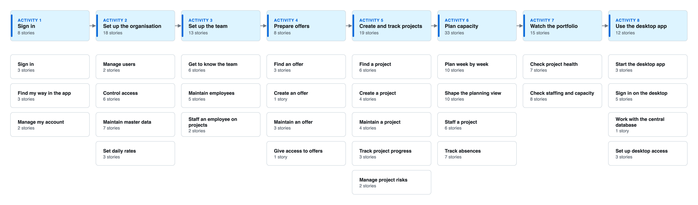

# Story map

This page lists all 126 user stories of Alloq on one map. The stories come from the code at v2.0.4, plus the offers that are not yet released. Each story lives on a feature page, and the map links to it. The map shows titles only. The acceptance criteria and the evidence are on the feature pages.

## Vision and goals

Alloq helps a software team plan which people work on which project in each week. It counts the free capacity of each person after absences, public holidays, part time and internal work, and it shows the state of the project portfolio. It also keeps the offers that the company sends to customers.

Alloq has five personas. Their goals come from the README and from the "so that" part of the stories.

**Administrator.**

- Decide who can sign in and what each person may read or change.
- Keep the roles, daily rates, departments and public holidays that the planning and the prices use.
- Give desktop users access to the central database.

**Project manager.**

- Plan people on projects week by week without overbooking anyone.
- Keep the data, status and risks of each project current.
- See the schedule, budget, risks and staffing gaps of the portfolio on one page.

**Employee.**

- Read the planning and the projects without changing them.
- Keep their own account and password up to date.

**Offer editor.**

- Keep all customer offers with their person days, cost and price in one list.
- Record when an offer was sent, and archive offers that are no longer relevant.
- Work on offers without access to the planning, the projects or the team.

**Desktop user.**

- Use Alloq as a macOS app with the Microsoft account, on the same central database, with no secret stored in the app.

## How to read the map

- **Activities.** The big steps of the user journey, from left to right in the order a new team uses Alloq. Each activity has one or two feature pages.
- **User tasks.** The columns of each table. A user task is something a person does, named from their point of view.
- **Sub-tasks.** Smaller steps and variants under a user task. They are not columns, but each story belongs to one. Each feature page lists its sub-tasks near the top.
- **Release slices.** The rows. A story sits in the row of the first release that contained it.
- **Priority.** Each story has a rank inside its sub-task, and core stories rank above comfort stories. Inside a cell, skeleton stories come first, then core stories, then comfort stories, each by rank.
- **Walking skeleton.** A bold **S** marks the smallest set of stories that gives a working path from sign in to seeing the load of a person.
- **Approximate release.** A star (\*) marks a story whose release is a best guess.

Slices are ordered by tag date. Tag v2.0.0 (2026-10-15) is an ancestor of v0.4.5 (2026-10-16), so a story names the first tag in time that contains it. Tags without new stories (v0.4.0, v0.4.1, v0.4.4, v0.4.5, v1.0.0, v2.0.1 to v2.0.3) have no row. A release marked approximate is a best guess from the history.

| Slice | Tag date |
| --- | --- |
| v0.2.0 | 2026-05-11 |
| v0.3.0 | 2026-10-03 |
| v0.4.2 | 2026-10-05 |
| v0.4.3 | 2026-10-05 |
| v2.0.0 | 2026-10-15 |
| v2.0.4 | 2026-10-18 |
| unreleased | not tagged yet |

## The journey

[Editable source: story-map.drawio](https://github.com/jenreh/alloq/blob/main/docs/diagrams/story-map.drawio)

People do not always follow this order:

- Offer editors with only the role "Angebote" skip every other activity. They sign in and go straight to the offers (OFF-08).
- Employees skip every setup step. They sign in and read the planning and the projects (AUTH-11, PLAN-28, PROJ-20).
- Admins set up the organisation once and come back when a role, rate, department or holiday changes. Roles must exist before an employee gets a key role (TEAM-07) and before a project asks for days per role (PROJ-08).
- Project managers can staff a new project with the wizard or the tab "Ressourcen" (PLAN-19, PROJ-18) instead of typing into the grid.
- A project can be created in the middle of an assignment (PROJ-21), so "Create and track projects" can come after planning has started.
- Absences can be recorded at any time, from the team page or from the planning page (TEAM-12, PLAN-26).
- Desktop users start at the last activity. They open the desktop app, sign in with Microsoft and then use the same pages as in the browser.

## The map

There is one table per activity. Rows without stories are left out.

### Sign in

Feature pages: [Sign in and find your way](./sign-in.md).

| Slice | Sign in | Find my way in the app | Manage my account |
| --- | --- | --- | --- |
| v0.2.0 | [AUTH-01 Sign in with email and password](./sign-in.md#auth-01) **S** [AUTH-02 Sign in with Microsoft](./sign-in.md#auth-02) [AUTH-03 Reset a forgotten password](./sign-in.md#auth-03) |  | [AUTH-04 Change profile and password](./sign-in.md#auth-04) |
| v2.0.0 |  | [AUTH-11 Sidebar shows allowed pages](./sign-in.md#auth-11) [AUTH-14 Hide the sidebar](./sign-in.md#auth-14) [AUTH-12 Sidebar counters](./sign-in.md#auth-12) | [AUTH-13 User menu](./sign-in.md#auth-13) |

### Set up the organisation

Feature pages: [Users and access](./users-and-access.md), [Roles, rates, departments and holidays](./master-data.md).

| Slice | Manage users | Control access | Maintain master data | Set daily rates |
| --- | --- | --- | --- | --- |
| v0.2.0 | [ADM-01 Manage users](./users-and-access.md#adm-01) | [AUTH-06 Trust HTTPS only from known proxies](./users-and-access.md#auth-06) | [ADM-03 Create roles](./master-data.md#adm-03) **S** [ADM-10 Keep public holidays per year](./master-data.md#adm-10) [ADM-04 Change or delete a role](./master-data.md#adm-04) [ADM-11 Change or delete a holiday](./master-data.md#adm-11) |  |
| v0.3.0 |  | [AUTH-05 Require a valid session](./users-and-access.md#auth-05) [AUTH-10 Test that every handler is guarded](./users-and-access.md#auth-10) | [ADM-12 Recurring holidays reduce capacity](./master-data.md#adm-12) |  |
| v0.4.2 |  | [AUTH-07 Build public links from the base URL](./users-and-access.md#auth-07) |  |  |
| v2.0.4 | [ADM-02 Give users access level and departments](./users-and-access.md#adm-02) | [AUTH-08 Three access levels by role](./users-and-access.md#auth-08) \* [AUTH-09 Check rights on the server](./users-and-access.md#auth-09) | [ADM-08 Create departments](./master-data.md#adm-08) [ADM-09 Rename or delete a department](./master-data.md#adm-09) | [ADM-05 Production cost and sales prices](./master-data.md#adm-05) [ADM-07 Set the contribution margins](./master-data.md#adm-07) [ADM-06 Manual list price](./master-data.md#adm-06) |

### Set up the team

Feature pages: [Team](./team.md).

| Slice | Get to know the team | Maintain employees | Staff an employee on projects |
| --- | --- | --- | --- |
| v0.2.0 | [TEAM-01 Open the team page](./team.md#team-01) **S** [TEAM-06 List or cards](./team.md#team-06) | [TEAM-07 Add an employee](./team.md#team-07) **S** [TEAM-09 Edit an employee](./team.md#team-09) [TEAM-08 Validate the employee form](./team.md#team-08) [TEAM-11 Delete an employee](./team.md#team-11) | [TEAM-14 Assign a project from the team page](./team.md#team-14) [TEAM-16 Remove a project from an employee](./team.md#team-16) |
| v2.0.0 | [TEAM-02 Load and free days for eight weeks](./team.md#team-02) [TEAM-03 Direct reports, filter and search](./team.md#team-03) [TEAM-04 Sort the team list](./team.md#team-04) [TEAM-05 Team inspector](./team.md#team-05) |  |  |
| v2.0.4 |  | [TEAM-10 Put an employee into a department](./team.md#team-10) |  |

### Prepare offers

Feature pages: [Offers](./offers.md).

| Slice | Find an offer | Create an offer | Maintain an offer | Give access to offers |
| --- | --- | --- | --- | --- |
| unreleased | [OFF-01 Offer list grouped by status](./offers.md#off-01) [OFF-03 Offer inspector](./offers.md#off-03) [OFF-02 Search, filter and sort offers](./offers.md#off-02) | [OFF-04 Create an offer](./offers.md#off-04) | [OFF-05 Edit an offer](./offers.md#off-05) [OFF-06 Change status and sent date in the inspector](./offers.md#off-06) [OFF-07 Archive and restore an offer](./offers.md#off-07) | [OFF-08 Give a user access to the offers only](./offers.md#off-08) |

### Create and track projects

Feature pages: [Find and create projects](./projects.md), [Maintain and track a project](./project-tracking.md).

| Slice | Find a project | Create a project | Maintain a project | Track project progress | Manage project risks |
| --- | --- | --- | --- | --- | --- |
| v0.2.0 | [PROJ-01 Project list](./projects.md#proj-01) **S** | [PROJ-06 Create a project](./projects.md#proj-06) **S** [PROJ-08 Required days per role](./projects.md#proj-08) [PROJ-07 Validate the project form](./projects.md#proj-07) | [PROJ-09 Project drawer with tabs](./project-tracking.md#proj-09) [PROJ-12 Delete a project](./project-tracking.md#proj-12) | [PROJ-13 Record a status](./project-tracking.md#proj-13) [PROJ-14 Correct the status history](./project-tracking.md#proj-14) [PROJ-15 Earned value chart](./project-tracking.md#proj-15) | [PROJ-16 Record a risk](./project-tracking.md#proj-16) [PROJ-17 Risk matrix](./project-tracking.md#proj-17) |
| v0.3.0 | [PROJ-04 Table or cards](./projects.md#proj-04) [PROJ-03 Sort the project table](./projects.md#proj-03) | [PROJ-21 Quick-create a project](./projects.md#proj-21) |  |  |  |
| v2.0.0 | [PROJ-02 Group, filter and search projects](./projects.md#proj-02) \* [PROJ-05 Project inspector](./projects.md#proj-05) |  | [PROJ-10 Change status in the inspector](./project-tracking.md#proj-10) |  |  |
| v2.0.4 | [PROJ-20 Read projects as an employee](./projects.md#proj-20) |  | [PROJ-11 Change period in the inspector](./project-tracking.md#proj-11) |  |  |

### Plan capacity

Feature pages: [Planning grid](./planning-grid.md), [Planning filters and view](./planning-view.md), [Staff a project](./staffing.md), [Absences and availability](./absences.md).

| Slice | Plan week by week | Shape the planning view | Staff a project | Track absences |
| --- | --- | --- | --- | --- |
| v0.2.0 | [PLAN-01 Team planning grid](./planning-grid.md#plan-01) **S** [PLAN-04 Free days row per employee](./planning-grid.md#plan-04) **S** [PLAN-05 Assign a project in the grid](./planning-grid.md#plan-05) **S** [DASH-14 One calculation of free days and load](./planning-grid.md#dash-14) \* **S** [PLAN-03 Save grid changes in one step](./planning-grid.md#plan-03) **S** [PLAN-09 Project view of the grid](./planning-grid.md#plan-09) [PLAN-06 Remove a project row](./planning-grid.md#plan-06) | [PLAN-07 Planning window of 3, 6 or 12 months](./planning-view.md#plan-07) [PLAN-10 Filter by employee, project, role](./planning-view.md#plan-10) \* [PLAN-14 Collapse blocks](./planning-view.md#plan-14) [PLAN-13 My projects, my team](./planning-view.md#plan-13) | [PLAN-19 Wizard: pick a project](./staffing.md#plan-19) [PLAN-20 Wizard: spread the effort](./staffing.md#plan-20) [PLAN-21 Wizard: choose people](./staffing.md#plan-21) [PLAN-22 Wizard: preview and save](./staffing.md#plan-22) | [TEAM-12 Record an absence](./absences.md#team-12) [TEAM-13 See and delete absences](./absences.md#team-13) |
| v0.3.0 | [PLAN-02 Type days into week cells](./planning-grid.md#plan-02) \* **S** [PLAN-08 Spreadsheet keys, paste, fill, undo](./planning-grid.md#plan-08) |  | [PROJ-18 Plan a person in Ressourcen](./staffing.md#proj-18) [PROJ-19 Change or delete a planned period](./staffing.md#proj-19) | [PLAN-23 Absence timeline](./absences.md#plan-23) [PLAN-26 Record an absence while planning](./absences.md#plan-26) |
| v0.4.3 |  | [PLAN-11 Only available people](./planning-view.md#plan-11) |  |  |
| v2.0.4 | [PLAN-28 Read the planning as an employee](./planning-grid.md#plan-28) | [PLAN-15 Compact rows](./planning-view.md#plan-15) [PLAN-12 Hide internal and absence rows](./planning-view.md#plan-12) [PLAN-16 Remember view settings](./planning-view.md#plan-16) [PLAN-17 Readable week headers and holidays](./planning-view.md#plan-17) [PLAN-18 Open the planning prefiltered](./planning-view.md#plan-18) |  | [PLAN-24 Coverage row](./absences.md#plan-24) [PLAN-27 Delete an absence on the timeline](./absences.md#plan-27) [PLAN-25 Upcoming absences](./absences.md#plan-25) |

### Watch the portfolio

Feature pages: [Portfolio overview](./portfolio.md), [Portfolio staffing and capacity](./portfolio-capacity.md).

| Slice | Check project health | Check staffing and capacity |
| --- | --- | --- |
| v0.3.0 |  | [DASH-16 Background load with cache](./portfolio-capacity.md#dash-16) \* |
| v2.0.0 |  | [DASH-15 Free capacity in the sidebar](./portfolio-capacity.md#dash-15) |
| v2.0.4 | [DASH-01 Open the portfolio overview](./portfolio.md#dash-01) [DASH-04 Schedule and budget chart](./portfolio.md#dash-04) [DASH-06 Risk grid](./portfolio.md#dash-06) [DASH-02 Placeholders and load error](./portfolio.md#dash-02) [DASH-05 Project side panel](./portfolio.md#dash-05) [DASH-07 Risks in a grid cell](./portfolio.md#dash-07) [DASH-03 Department or my scope](./portfolio.md#dash-03) | [DASH-08 Projects with low staffing buffer](./portfolio-capacity.md#dash-08) [DASH-11 Capacity per role for 13 weeks](./portfolio-capacity.md#dash-11) [DASH-13 Person side panel](./portfolio-capacity.md#dash-13) [DASH-09 Buffer per project role](./portfolio-capacity.md#dash-09) [DASH-10 Person to look at and reason](./portfolio-capacity.md#dash-10) [DASH-12 Role side panel](./portfolio-capacity.md#dash-12) |

### Use the desktop app

Feature pages: [Desktop app](./desktop.md).

| Slice | Start the desktop app | Sign in on the desktop | Work with the central database | Set up desktop access |
| --- | --- | --- | --- | --- |
| v2.0.0 | [DESK-09 Native window with embedded backend](./desktop.md#desk-09) [DESK-10 Desktop configuration profile](./desktop.md#desk-10) [DESK-08 Splash screen](./desktop.md#desk-08) | [DESK-01 Microsoft sign-in only](./desktop.md#desk-01) [DESK-06 Sign out on the desktop](./desktop.md#desk-06) [DESK-02 Only known, active users](./desktop.md#desk-02) [DESK-03 Refuse a wrong schema version](./desktop.md#desk-03) [DESK-05 Restore the account from the Keychain](./desktop.md#desk-05) | [DESK-04 Own Entra token per connection](./desktop.md#desk-04) | [DESK-07 Grant database access](./desktop.md#desk-07) \* [DESK-11 Ship no secrets](./desktop.md#desk-11) [DESK-12 Run locally with a faked sign-in](./desktop.md#desk-12) |

## Walking skeleton

These stories give the shortest working path from sign in to seeing the free days and the load of a person. All of them are in v0.2.0 except PLAN-02, which the history places in v0.3.0 as a best guess.

1. [AUTH-01 Sign in with email and password](./sign-in.md#auth-01). An admin signs in with email and password.
2. [ADM-03 Create roles](./master-data.md#adm-03). The admin creates the roles that employees and projects use.
3. [TEAM-01 Open the team page](./team.md#team-01). A project manager opens the team page.
4. [TEAM-07 Add an employee](./team.md#team-07). The project manager adds an employee with a key role and weekly hours.
5. [PROJ-01 Project list](./projects.md#proj-01). The project manager opens the project list.
6. [PROJ-06 Create a project](./projects.md#proj-06). The project manager creates a project with its master data.
7. [PLAN-01 Team planning grid](./planning-grid.md#plan-01). The project manager opens the planning grid.
8. [PLAN-05 Assign a project in the grid](./planning-grid.md#plan-05). The project manager assigns the project to the employee.
9. [PLAN-02 Type days into week cells](./planning-grid.md#plan-02) \*. The project manager types person-days into the week cells.
10. [PLAN-03 Save grid changes in one step](./planning-grid.md#plan-03). The project manager saves the grid changes.
11. [PLAN-04 Free days row per employee](./planning-grid.md#plan-04). The grid shows planned and free days per week for the employee.
12. [DASH-14 One calculation of free days and load](./planning-grid.md#dash-14) \*. The shared calculation gives the free days and the load percent.

## Not covered

The code below has no story. Each line says why.

| Code | Reason |
| --- | --- |
| Old dashboard KPI cards and drill-down drawer (kpi_card.py, utilization_cards.py, earned_value_card.py, top_risks_card.py, project_cards.py, capacity_card.py, drill_down_drawer.py) | No page mounts them since v2.0.4 (62ed8ab). The dashboard shows only the four portfolio cards. |
| States behind the old cards: DashboardState.load_all, open_drill_down, close_drill_down, UtilizationState.load, UnderUtilizationState.load, ProjectsOverviewState.load, ProjectHealthState.load, RiskState.load, BudgetBurnState.load | Nothing on a mounted page triggers them, or their result is not shown. ProjectState still refreshes ProjectHealthState and RiskState after a risk change. |
| aggregation.py loaders load_projects_overview, load_project_health, load_budget_burn, load_utilization, load_under_utilization, load_risks | They feed only the unmounted KPI cards. load_free_capacity is covered by DASH-15. |
| /oauth/google/callback and /oauth/apple/callback | Registered by importing appkit_user pages. Alloq configures no Google or Apple provider and shows no button. |
| appkit_user UserState handlers (load, create, update, delete users) | External package. ADM-01 and ADM-02 describe how Alloq wires them. |
| ProjectState.status_filter | No handler sets it, so it is always "all". Open question in PROJ-02. |
| Unused repository methods: AbsenceRepository.find_active_by_employee_id, PublicHolidayRepository.find_all_paginated, CapacityAllocationRepository.upsert_cell, replace_for_project_employee, find_by_employee_in_range, ProjectRepository.find_all_paginated search argument | No caller outside the repository or its tests. |
| UtilizationService.compute_project_heat, planning_week_starts, week_label | No caller outside utilization.py. |
| EmployeeUpdate (models/employee.py) | Write model with no caller. update_employee uses EmployeeCreate. |
| Shared UI helpers in alloq_commons/components (list_view.py, toolbar.py, modal_layout.py, dialogs.py, formatters.py, table_styles.py, view_mode_toggle.py) and planning_filter_row.jsx | Building blocks without a rule of their own. Stories that use them name them as evidence. |
| aggregation_rows.py and _CardLoadMixin | Internal support code. Their visible behaviour is covered by DASH-15 and DASH-16. |

## Keep the map alive

Every change that a user can notice adds, changes or removes a story on its feature page and on this map, in the same pull request. The steps are in [Contributing](../guide/contributing.md#keep-the-story-map-alive).
