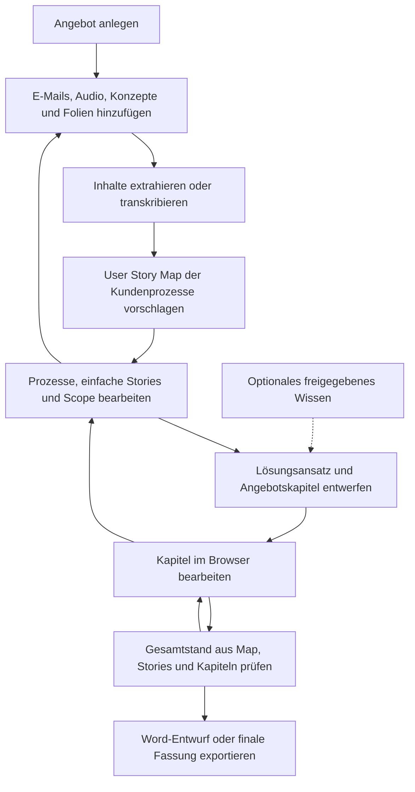
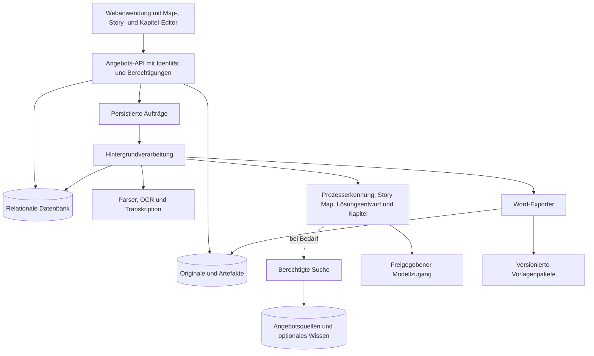

# Konzept: KI-gestützte Angebotswerkstatt

**Version:** 1.1 – Prozess- und User-Story-orientierter Konzeptentwurf
**Stand:** 23. Oktober 2026
**Zielgruppe:** Management, Solution Architecture und Entwicklung
**Anwendungsbereich:** Angebote für Software-, AI-, Agenten- und Data-Science-Projekte

**Lesepfad:** Die folgende Story Map zeigt das fachliche Zielbild. Für eine Managemententscheidung folgen die Abschnitte 1–6 und 17–20. Die Abschnitte 7–15 beschreiben den fachlichen und technischen Vertrag für eine Umsetzung.

## User Story Map als Ausgangspunkt jedes Angebots

Jedes Angebot beginnt fachlich mit einer **User Story Map der umzusetzenden Kundenprozesse**. Nach dem Einlesen der Quellen ist sie das erste fachliche Arbeitsartefakt im Browser. Im Word-Angebot steht sie am Anfang des fachlichen Inhalts, nach gegebenenfalls erforderlichem Deckblatt und Inhaltsverzeichnis. Die Karte beschreibt das geplante Kundenprojekt. Der Ablauf der Angebotswerkstatt selbst ist davon getrennt.

Die Struktur orientiert sich an der [Alloq Story Map](/Users/Jens.Rehpoehler/Workspace/Projekte/alloq/docs/features/story-map.md): Vision und Rollen, Aktivitäten entlang der Nutzerreise, Aufgaben und untergeordnete Stories, Umfangsschnitte sowie ein kleinster durchgängiger Ablauf. Während Alloq bestehendes Verhalten und historische Releases dokumentiert, beschreibt eine Angebotskarte **geplante Umsetzung und vorgeschlagenen Umfang**. Ohne Kundengrundlage werden keine erledigten Funktionen, beschlossenen Releases oder vollständigen Prozesse behauptet.

### Beispiel: Kundenanfragen bearbeiten

Das Beispiel zeigt einen möglichen Kundenprozess für ein Software-/AI-Projekt. Es sind keine festgestellten Kundenanforderungen. Die Spalten beschreiben Aktivitäten und darunter die zugehörigen Aufgaben. Die weiteren Zeilen bilden vorgeschlagene Umsetzungsschnitte ab. Stories und ihre Erläuterungen erhalten keine Akzeptanzkriterien.

| Vorgeschlagener Umfang | Anfrage aufnehmen | Anliegen verstehen | Bearbeitung steuern | Antwort erstellen | Vorgang abschließen |
|---|---|---|---|---|---|
| Aufgaben | Anfrage erfassen | Inhalt einordnen | Zuständigkeit festlegen | Antwort formulieren und überarbeiten | Bearbeitungsstand abschließen |
| Erste durchgängige Fassung | [ANF-01 Anfrage erfassen](#anf-01) **S** | [ANF-02 Anliegen verstehen](#anf-02) **S** | [ANF-03 Zuständigkeit zuweisen](#anf-03) **S** | [ANF-04 Antwort überarbeiten](#anf-04) **S** | [ANF-05 Vorgang abschließen](#anf-05) **S** |
| Mögliche Erweiterung, noch nicht angeboten | Mehrere Eingangskanäle bündeln | Ähnliche Vorgänge erkennen | Übergaben und Rückfragen unterstützen | Antwortvorschläge vorbereiten | Wiederkehrende Anliegen auswerten |

**S** bezeichnet den vorgeschlagenen Walking Skeleton: einen kleinen, aber nutzbaren Ablauf über die relevanten Aktivitäten hinweg. Erweiterungen sind hier Ideentitel, keine ausformulierten Stories und keine automatisch zugesagten Leistungen. Im echten Angebot erhalten vorgeschlagene Stories eine Herkunftskennzeichnung.

#### ANF-01

Als Sachbearbeiter möchte ich eine Kundenanfrage erfassen, um sie nachvollziehbar bearbeiten zu können.

#### ANF-02

Als Sachbearbeiter möchte ich das Anliegen einer Anfrage verstehen, um den nächsten Bearbeitungsschritt festzulegen.

#### ANF-03

Als Teamkoordinator möchte ich eine Anfrage einer zuständigen Person zuweisen, um ihre Bearbeitung zu organisieren.

#### ANF-04

Als Sachbearbeiter möchte ich eine Antwort formulieren und überarbeiten, um das Anliegen des Kunden verständlich zu beantworten.

#### ANF-05

Als Sachbearbeiter möchte ich einen bearbeiteten Vorgang abschließen, um seinen Bearbeitungsstand festzuhalten.

Die Map verknüpft jeden Story-Titel mit genau einer Story. Rollen, Reihenfolge und gewünschter Nutzen werden aus Quellen erkannt oder als Vorschlag gekennzeichnet. Das Muster erzwingt keine lineare Bearbeitung: Rückfragen, Schleifen, alternative Wege und Übergaben können ergänzt werden. Liegen noch keine Quellen vor, zeigt die Anwendung eine leere Map mit offenen Leitfragen statt erfundener Kundenprozesse.

## 1. Entscheidungsvorschlag

Eine webbasierte Angebotswerkstatt führt E-Mails, Gesprächsmitschnitte, Konzepte und Präsentationen in einem gemeinsamen Angebotsarbeitsraum zusammen. Ihr fachlicher Mittelpunkt sind die **Kundenprozesse, die durch das Projekt umgesetzt oder verändert werden sollen**. Die Anwendung erkennt Rollen, Ziele, Aktivitäten und Aufgaben, erstellt daraus eine User Story Map mit einfachen User Stories und leitet daraus einen kapitelweisen Angebotsentwurf ab. Nutzer überarbeiten Map, Stories und Kapitel im Browser. Anschließend entsteht ein editierbares Word-Dokument auf Grundlage der vorhandenen Vorlage.

Empfohlen wird ein **iterativer fachlicher Entwurfsprozess mit klaren technischen Zuständigkeiten und menschlicher Entscheidungshoheit**. Die Anwendung steuert Speicherung, Versionen, Berechtigungen und Export verlässlich. Sprachmodelle helfen beim Verstehen unvollständiger Eingaben, beim Rekonstruieren und Entwerfen von Prozessen, beim Formulieren von Stories und beim Erarbeiten einer passenden Lösung. Die fachliche Arbeit darf zwischen Quellen, Map, Stories und Kapiteltext zurückspringen.

Der zentrale Architekturentscheid lautet:

> Die User Story Map mit ihren einfachen Stories ist das erste fachliche Startartefakt und die gemeinsame Grundlage für Leistungsumfang, Lösung und Angebotskapitel. Kundenmaterial, neue Nutzerentscheidungen und fachliche Entwurfsarbeit treiben den Inhalt. Unternehmenswissen ergänzt bei Bedarf. Die Anwendung verwaltet den verbindlichen Bearbeitungsstand und überführt ihn in die vorhandene Word-Vorlage.

„Best of Breed“ bezeichnet hier die Auswahl geeigneter Bausteine und Verantwortlichkeiten. Es ist keine Behauptung, ein bestimmtes Modell oder Produkt sei ohne Vergleichstest überlegen.

## 2. Grundlage, Vorgaben und Annahmen

### 2.1 Vorgaben aus der Aufgabenstellung

- Ein neues Angebot kann E-Mails, Mitschnitte von Kundengesprächen sowie Konzepte und PowerPoint-Präsentationen als Eingabe erhalten.
- Gegenstand sind insbesondere Software-, AI-, Agenten- und Data-Science-Projekte.
- Ausgangspunkt sind umzusetzende Kundenanforderungen und die zugehörigen fachlichen Prozesse.
- Das erste fachliche Arbeitsergebnis und der Anfang des fachlichen Angebotsinhalts sind immer eine User Story Map.
- Prozesse werden aus den Eingaben erkannt und in einfachen User Stories aus Rolle, Ziel und Nutzen beschrieben. Die Stories enthalten **keine Akzeptanzkriterien**.
- Unternehmenswissen ist eine optionale Ergänzung. Ein vollständiger fachlicher Erstentwurf muss ohne Unternehmenswissensbasis möglich sein.
- Eine **vorhandene Word-Angebotsvorlage** soll übernommen werden.
- Kapitel werden auf einer Webseite angezeigt und können dort bearbeitet werden.
- Nach der Überarbeitung lässt sich ein editierbares Word-Dokument erzeugen.
- Das Konzept soll über einzelne Kunden und Angebotsarten hinaus wiederverwendbar sein.

### 2.2 Vorgeschlagene Ausgangsentscheidungen

Diese Punkte sind Empfehlungen des Konzepts, keine bereits vereinbarten Produktvorgaben:

- Eigenständige Anwendung mit möglicher Wiederverwendung geeigneter WW-KonzAI-Bausteine.
- Im ersten Umfang Upload und Einfügen von Inhalten; automatische Postfach-, CRM- und Meetinganbindungen folgen bei Bedarf.
- Ein verantwortlicher Bearbeiter je Kapitel zur selben Zeit; gleichzeitige Live-Zusammenarbeit ist zunächst nicht erforderlich.
- Deutsch als erste Ausgabesprache. Sprache und Stil werden später über das Vorlagenpaket erweitert.
- Zunächst eine konkrete Word-Vorlage produktiv anbinden. Weitere Vorlagen verwenden dasselbe Vertrags- und Prüfmodell.
- Nutzer können Entwürfe exportieren. Für eine als final bezeichnete Fassung gelten die in Abschnitt 11 festgelegten Prüfregeln.
- Strukturierte Felder sind für bestätigte Geschäftsdaten verbindlich; redaktionelle Änderungen werden über einen ausdrücklichen Abgleich damit verbunden. Die Übernahme eines KI-Textvorschlags bestätigt noch keine fachliche Entscheidung.
- Keine automatische Übermittlung eines Angebots an Kunden.

Die tatsächliche Word-Datei wurde für dieses Konzept noch nicht untersucht. Deshalb sind konkrete Kapitel, Formatierungsregeln und technische Einschränkungen der Vorlage vor der Umsetzung zu prüfen. Die Beispielgliederung in Abschnitt 6 ersetzt diese Prüfung nicht.

## 3. Übernommene Stärken aus EAM und WW-KonzAI

| Herkunft | Übernommene Stärke | Verallgemeinerung |
|---|---|---|
| EAM | Strukturierung unvollständiger Eingaben in Aufgaben und Kriterien | Kundenprozesse mit Rollen, Aktivitäten, Aufgaben und einfachen Stories rekonstruieren |
| EAM | Suche in vorhandenen Angeboten und größeren fachlichen Kontexten | Optionale Ergänzung durch berechtigtes Wissen; keine notwendige Grundlage der Prozesserkennung |
| EAM | Gesonderte Evidenz- und Inhaltsprüfung | Kombination aus regelbasierten Prüfungen und ergänzendem KI-Review |
| WW-KonzAI | Verlässliche Hintergrundaufträge und Zustände | Technisch kontrollierte Verarbeitung bei freier fachlicher Iteration |
| WW-KonzAI | Strukturierte Matrix mit Quellen und Hinweisen | Versionierte Story Map als Verbindung zwischen Quellen, Stories, Leistungsumfang und Kapiteln |
| WW-KonzAI | Dokumentaufbau durch Anwendungscode | Word-Export aus einem festen Bearbeitungsstand mit versionierter Vorlage |

Die wichtigste fachliche Abweichung ist der Ausgangspunkt: Das Kundenprojekt wird aus seinen Anforderungen und Prozessen entworfen. Bereits vorhandene Unternehmensleistungen oder Angebotstexte bestimmen diesen Entwurf nicht. Hinzu kommen ein Map- und Story-Editor, ein Kapitel-Editor, der Schutz manueller Änderungen, die Übernahme der Word-Vorlage und ein belastbarer Umgang mit kommerziellen Aussagen.

## 4. Zielbild und Nutzen

Der Nutzer erhält zuerst ein verständliches Bild der umzusetzenden Kundenprozesse und danach einen daraus abgeleiteten Angebotsentwurf. Er erkennt, welche Prozessschritte vom Kunden beschrieben wurden, welche als notwendige Ergänzung vorgeschlagen werden und wo fachliche Entscheidungen fehlen. Er kann Scope, Stories und Formulierungen unmittelbar weiterbearbeiten.

Die Anwendung soll:

1. Die aktive Arbeitszeit vom Informationspaket bis zum fachlich verwendbaren Entwurf reduzieren.
2. Kundenanforderungen über eine User Story Map mit einfachen Stories, Leistungsumfang, Ergebnissen und Angebotskapiteln verbinden.
3. Fehlende Angaben und Widersprüche sichtbar machen, bevor daraus unbeabsichtigte Zusagen werden.
4. Manuelle Überarbeitungen dauerhaft erhalten und kontrollierte Neugenerierung ermöglichen.
5. Browserinhalt und exportiertes Word inhaltlich konsistent halten.

Ein Angebot gilt nicht allein deshalb als fachlich richtig, weil die Generierung erfolgreich war. Die verantwortlichen Nutzer entscheiden über Lösung, Umfang und Zusagen.

## 5. Durchgängiger Nutzerablauf



### 5.1 Angebot anlegen

Nutzer vergeben einen Namen und ordnen den Kunden zu. Das vorhandene Vorlagenpaket ist voreingestellt oder auswählbar. Die leere Story-Map-Ansicht bildet den Einstieg. Optionale Felder sind Ansprechpartner, Angebotsart, Termin, Sprache und Vertriebsreferenz. Fehlende Angaben verhindern das Anlegen nicht; sie werden nicht durch erfundene Prozessinhalte ersetzt.

### 5.2 Quellen hinzufügen

Uploads und eingefügte Inhalte erhalten einen Verarbeitungsstatus. Die Oberfläche zeigt, welche Dateien nutzbar sind und wo beispielsweise eine Transkription, OCR oder manuelle Ergänzung notwendig ist. Neue Quellen können auch nach dem ersten Entwurf hinzukommen.

### 5.3 Kundenprozesse und User Story Map vorbereiten

Nach der Quellenaufnahme schlägt die Anwendung zunächst Rollen, Ziele und Kundenaktivitäten vor. Darunter ordnet sie Aufgaben und einfache User Stories ein. Die Map macht fachliche Zusammenhänge, Übergaben, Reihenfolge, Varianten und erkennbare Lücken sichtbar. Quellen sind erreichbar, stehen aber nicht anstelle einer verständlichen Prozessbeschreibung.

Nutzer können Aktivitäten umbenennen, Stories ergänzen, verschieben oder aufteilen und einen ersten durchgängigen Umfang markieren. Fehlende Rollen, Schritte oder Ziele werden als offene Fragen geführt. Die Anwendung darf Vorschläge machen; sie unterscheidet diese von ausdrücklich beschriebenem Kundenbedarf. Prioritäten, Slices und der angebotene Scope werden nicht aus fehlenden Angaben erfunden.

### 5.4 Fachlichen Entwurf iterativ ausarbeiten

Parallel zur Map zeigt die Anwendung Ausgangslage, Randbedingungen, Budgetinformationen, Termine und offene Entscheidungen. Der Nutzer kann zwischen Quellen, Stories, Scope und Lösungsansatz wechseln. Neues Verständnis darf die Prozessstruktur verändern; die erste Map ist ein Ausgangsentwurf und kein unveränderlicher Plan.

Mit offenen Punkten darf weitergearbeitet werden. Der Umgang mit kritischen Scope-Konflikten und kommerziellen Festlegungen bleibt ausdrücklich geregelt. Eine vollständige Einzelbestätigung aller extrahierten Sätze oder jedes Bearbeitungsschritts ist nicht erforderlich.

### 5.5 Kapitel erstellen und bearbeiten

Erst auf Basis einer versionierten Map werden die Kapitel der Vorlage entworfen. Nutzer können Texte und Tabellen bearbeiten, Abschnitte ergänzen und gezielt KI-Vorschläge anfordern. Die zugehörigen Stories bleiben erreichbar. Map und Story-Katalog sind gespeicherte Fachobjekte; ihre Darstellung im Kapiteltext ist eine Projektion desselben Stands.

Neue Vorschläge erscheinen als Vergleich zum aktuellen Stand. Erst die Übernahme ändert den verbindlichen Inhalt. Ein leeres Unternehmenswissensarchiv verhindert weder Map noch Stories oder Kapitelentwurf.

Der Reiter „Kapitel“ zeigt das Angebot als ein Dokument. Links steht die Gliederung, rechts ein Bereich mit den Einstellungen des gewählten Kapitels. Jedes Angebot hat eine eigene Gliederung, die beim Anlegen aus der gebundenen Vorlagenversion kopiert wird. Für die Gliederung gelten diese Regeln:

- Über „+ Kapitel“ kommt ein Baustein aus der Bibliothek mit Startinhalt und Einstellungen hinzu, oder ein leeres Kapitel vom Typ Text, Tabelle, Stories oder Kalkulation. Jeder Baustein steht höchstens einmal in der Gliederung. Ein Angebot hat höchstens 100 Kapitel.
- Pflichtkapitel lassen sich verschieben, aber nicht entfernen. Ein entferntes Kapitel behält Revisionen, Prüfhinweise und Vorschläge und lässt sich wiederherstellen. Nach dem Wiederherstellen steht es am Ende der Gliederung und ist zur Prüfung markiert.
- Kapitel werden in der Gliederung mit Maus oder Tastatur verschoben. Der feste Rahmen des Word-Layouts gehört nicht zur Gliederung und bleibt an seinem Platz.
- Jedes Kapitel hat einen eigenen Titel und die Ebene Kapitel oder Unterkapitel. Das erste Kapitel hat immer die Ebene Kapitel. Die Nummern (1, 2, 2.1, 3) ergeben sich aus Reihenfolge und Ebene, in der Werkstatt und im Word-Dokument.

### 5.6 Word erzeugen

Vor dem Export werden alle Änderungen gespeichert und ein fester Dokumentstand gebildet. Der Nutzer sieht die Ausgabeart und vorhandene Blocker. Der Export verwendet diesen Stand sowie die zugeordnete Version der Word-Vorlage. Spätere Bearbeitungen verändern eine bereits erzeugte Datei nicht.

## 6. Vorlagenmodell: vorhandenes Word und bearbeitbare Kapitel

### 6.1 Ein versioniertes Vorlagenpaket

Ein Vorlagenpaket besteht aus drei zusammengehörigen Teilen:

| Bestandteil | Aufgabe |
|---|---|
| Kapiteldefinition | Stabile Kapitel-IDs, Pflichtstatus und Inhaltsregeln; die User Story Map beginnt den fachlichen Inhalt, gefolgt von verknüpften Stories und Angebotskapiteln |
| Word-Layoutdatei | Bestehende Corporate-Vorlage mit Formatvorlagen, Kopf- und Fußzeilen, Platzhaltern und wiederholbaren Bereichen |
| Generierungs- und Prüfregeln | Leitfragen, Stil, verbindliche Textbausteine, benötigte Informationen und kapitelbezogene Prüfungen |

Alle Teile werden gemeinsam versioniert und auf Kompatibilität geprüft. Ein Angebot bindet eine konkrete Paketversion. Ein Vorlagenwechsel ist eine ausdrückliche Migration mit Vorschau; er verändert vorhandene Angebote nicht automatisch.

Vorlagen, Kapitelbausteine und KI-Prompts liegen in der Datenbank. Administratoren und Nutzer mit der Rolle „Angebotsverwaltung“ (`offer_admin`) pflegen sie im Menü „Angebote“ der Administration (`/admin/offers`) mit drei Reitern:

| Reiter | Inhalt |
|---|---|
| Vorlagen | Entwurf der Gliederung aus Bausteinen mit Titel, Ebene und Pflichtstatus je Eintrag; Hochladen des Word-Layouts; Veröffentlichen als nächste Version; Liste der Versionen |
| Kapitelbausteine | Bibliothek der Kapitel mit Schlüssel, Titel, Typ, Ebene, Leitfrage, Inhaltsregeln, Prompt-Ergänzung, Pflichtangaben, Prüfungen und Startinhalt; ein Baustein in einer Vorlage wird deaktiviert statt gelöscht |
| Prompts | Neue Version eines Prompts speichern oder eine ältere aktivieren; jede Version zeigt Autor, Zeitpunkt und die geänderten Zeilen |

Das Veröffentlichen kopiert Gliederung, Baustein-Einstellungen und Layout in eine unveränderliche Version. Eine Version ohne Änderung zur letzten wird nicht angelegt. Neue Angebote nutzen die neueste Version, bestehende Angebote behalten ihre. Das hochgeladene Layout braucht genau einen Anker `[[KAPITEL]]` und wird vor dem Speichern von Kommentaren, Personen, Autoren, Änderungsverfolgung und externen Verknüpfungen bereinigt. Eine feste Regel zu den Daten-Tags steht vor jedem Prompt und lässt sich im Menü nicht entfernen. Jeder KI-Lauf speichert die Prompt-Version, die er genutzt hat.

### 6.2 Übernahme der bestehenden Word-Vorlage

1. **Inventarisieren:** Kapitel, Formatvorlagen, Tabellen, Nummerierung, Inhaltsverzeichnis, Abschnitte, Bilder, Pflichtformulierungen und Formularfelder erfassen. Die User Story Map mit verknüpftem Story-Katalog am Beginn des fachlichen Inhalts verankern; fehlt dieser Bereich, wird die Vorlage gezielt ergänzt.
2. **Inhalt zuordnen:** Veränderliche Bereiche erhalten stabile IDs. Feste Texte und durch Nutzer editierbare Bereiche werden ausdrücklich ausgewiesen.
3. **Technisch vorbereiten:** Geeignete Platzhalter und Wiederholungsbereiche in einer Kopie der Vorlage ergänzen. Generierter Inhalt darf keine neue Vorlagenlogik ausführen.
4. **Fähigkeiten testen:** Eine Referenzdatei mit kurzen und langen Kapiteln, Tabellen, Listen und Sonderzeichen erzeugen. Mit der Ausgangsvorlage in Word vergleichen.
5. **Paket freigeben:** Nur geprüfte Kombinationen aus Layout, Kapiteldefinition und Exporter werden angeboten.

Ein automatischer Erstvorschlag für die Kapitelzuordnung ist möglich. Die beliebige, verlustfreie Umwandlung jeder Word-Datei in einen Webeditor wird nicht vorausgesetzt. Komplexe Textfelder, verschachtelte Tabellen, spezielle Nummerierung und eingebettete Objekte können eine Anpassung der Vorlage erfordern.

### 6.3 Beispiel einer fachlichen Angebotsstruktur

Die vorhandene Vorlage bleibt die Layoutgrundlage. Die Vorgabe, fachlich mit einer Story Map zu beginnen, wird bei ihrer Übernahme ausdrücklich umgesetzt. Folgende Inhalte dienen als Zuordnungshilfe:

| Inhalt | Leitfrage |
|---|---|
| User Story Map und einfacher Story-Katalog | Welche Kundenprozesse, Aufgaben und Nutzerziele sollen umgesetzt werden? |
| Management Summary | Welches Problem lösen wir und welchen Nutzen soll das Projekt schaffen? |
| Ausgangssituation und Zielbild | Was ist bekannt und woran wird der Erfolg gemessen? |
| Leistungsumfang und Abgrenzung | Welche Stories beziehungsweise Prozessumfänge werden angeboten und welche bleiben offen oder außerhalb? |
| Lösung und Architektur | Wie soll die Lösung funktionieren und welche Varianten sind offen? |
| Vorgehen und Arbeitspakete | Welche Schritte, Ergebnisse und Abhängigkeiten sind vorgesehen? |
| Projektorganisation und Mitwirkung | Welche Rollen, Entscheidungen und Kundenzulieferungen sind erforderlich? |
| Qualitätsvorgehen und gegebenenfalls allgemeine Abnahmeregelung | Wie gehen wir mit Qualität und einer vertraglichen Abnahme um, ohne Story-Akzeptanzkriterien zu erzeugen? |
| Aufwand, Vergütung und Konditionen | Auf welcher freigegebenen Kalkulation beruht das Angebot? |
| Annahmen und Risiken | Welche Voraussetzungen und Unsicherheiten beeinflussen die Leistung? |

Wiederverwendbarkeit entsteht durch Vorlagen und fachliche Inhaltsprofile. AI-, Agenten- oder Data-Science-Angebote können zusätzliche Leitfragen erhalten, ohne die gesamte Verarbeitungskette auszutauschen.

## 7. Quellenverarbeitung

### 7.1 Eingabeformate des ersten funktionsfähigen Umfangs

| Quelle | Aufnahme | Zu erhaltende Informationen |
|---|---|---|
| E-Mail | EML-Datei oder eingefügter Nachrichtentext; Anlagen als eigene Quellen | Betreff, Nachrichtendatum, Absenderrolle, Nachrichten-ID soweit vorhanden, zitierte Kette und Anlagenbezug |
| Gesprächsmitschnitt | Audio-Upload, mindestens WAV, MP3 und M4A nach geprüfter Normalisierung | Transkript, Zeitmarken, Sprecherkennungen und erkennbare Unsicherheiten |
| Vorhandenes Transkript | TXT, DOCX oder eingefügter Text | Abschnitte, Sprecher und Zeitmarken soweit vorhanden |
| Konzept | DOCX und PDF | Überschriften, Absätze, Tabellen, Seiten und Quellenpositionen |
| Präsentation | PPTX; alternativ PDF-Export | Foliennummer, Texte, Tabellen, Sprechernotizen soweit extrahierbar und sichtbare Folienansicht |

MSG-Dateien, automatische Postfachimporte und Meetingplattform-Anbindungen sind Erweiterungen. Der erste Umfang erfüllt die E-Mail-Eingabe über EML und eingefügten Text.

### 7.2 Normalisierung mit nachvollziehbarer Herkunft

Jede Quelle erhält eine unveränderliche Version mit Prüfsumme, Angebotseigentümer, Berechtigungen, Importzeit und Verarbeitungsinformationen. Extrahierte Blöcke referenzieren das Original:

- PDF: Seite und gegebenenfalls Position.
- DOCX: Absatz oder Tabelle; eine stabile Seitenzahl wird nicht vorausgesetzt.
- PPTX: Folie, Textbereich oder Notiz.
- Audio: Zeitintervall und technische Sprecherkennung.
- E-Mail: Nachricht und Textabschnitt.

Original, extrahierter Inhalt und daraus abgeleitete Aussagen bleiben getrennte Artefakte. Ein ersetztes Dokument wird als neue Version gespeichert. Eine wiederholte identische Einreichung erzeugt keine unnötigen Modellaufrufe.

### 7.3 Besondere Regeln

- **E-Mails:** Zitierte Nachrichten und Signaturen erkennen, Duplikate markieren, unterschiedliche Fassungen und Anlagen erhalten. Das Nachrichtendatum allein entscheidet nicht über die Gültigkeit einer Aussage.
- **Audio:** Sprechertrennung ist keine Identitätsprüfung. Die Zuordnung „Kunde“ oder „Anbieter“ muss aus bekannten Teilnehmern stammen oder bestätigt werden. Kritische Zahlen, Verneinungen und Zusagen bleiben überprüfbar.
- **Folien:** Text, Bilder und Diagramme können verschiedene Aussagen enthalten. Folienansichten müssen zur Kontrolle erreichbar sein. Relevante bildbasierte Inhalte werden über einen freigegebenen visuellen Verarbeitungsschritt erschlossen oder als nicht ausgewertet markiert; sie gelten nicht stillschweigend als verstanden.
- **PDFs:** Native Extraktion bevorzugen; für gescannte Inhalte OCR einsetzen. Gemischte Dateien und teilweise fehlgeschlagene Seiten sichtbar ausweisen.
- **Fehler:** Für Entwürfe dürfen Nutzer ausdrücklich nur die nutzbaren Quellen auswählen. Ausgelassene oder fehlgeschlagene Quellen bleiben sichtbar; ein Teilergebnis darf keine vollständige Verarbeitung behaupten.

Azure Document Intelligence ist eine mögliche Ergänzung für Layout- und OCR-Verarbeitung. Seine Unterstützung für Office-Text ersetzt nicht automatisch die Auswertung eingebetteter Bilder. Azure Speech bietet Transkriptionsverfahren mit Zeitmarken und Sprechertrennung; Modus, Laufzeit und Grenzen sind für reale Mitschnitte zu prüfen. [Layout-Dokumentation](https://learn.microsoft.com/azure/ai-services/document-intelligence/prebuilt/layout), [Transkriptionsdokumentation](https://learn.microsoft.com/en-us/azure/ai-services/speech-service/batch-transcription-create)

## 8. Prozessmodell, Story Map und einfache User Stories

Zwischen Kundeneingaben und Angebotskapiteln liegt ein leichtgewichtiges fachliches Modell. Im Mittelpunkt stehen die Kundenprozesse und die daraus abgeleiteten einfachen User Stories. Die Map wird vor den Kapiteln angelegt und über den gesamten Entwurfsprozess gepflegt.

### 8.1 Inhaltstypen

| Typ | Bedeutung | Beispiel | Verwendung |
|---|---|---|---|
| Kundenanforderung | Geäußerter Bedarf oder vorgegebene Bedingung | „Dokumente müssen nach Berechtigung gefiltert werden.“ | Als Anforderung mit Quellenbezug darstellen |
| Belegter Sachverhalt | Durch eine Quelle gestützte Aussage | „Im Bestand wird System X eingesetzt.“ | Mit Herkunft und Gültigkeitskontext verwenden |
| Bestätigte Festlegung | Durch verantwortlichen Nutzer akzeptierte Entscheidung | „Phase 1 umfasst ausschließlich internen Zugriff.“ | Als Planungsgrundlage verwenden |
| Lösungsvorschlag | Von der KI oder einem Nutzer vorgeschlagene Ausgestaltung | „Wir schlagen einen Retrieval-Service vor.“ | Als Vorschlag formulieren, zur Prüfung anbieten |
| Annahme | Für den Entwurf notwendige, unbestätigte Voraussetzung | „API-Zugriff wird vor Projektstart bereitgestellt.“ | Sichtbar kennzeichnen und einer Verantwortung zuordnen |
| Kommerzielle Festlegung | Freigegebener Preis, Termin oder Leistungsumfang | Bestätigtes Budget beziehungsweise Angebotskalkulation | Aus kontrollierten Feldern übernehmen |
| Offener Punkt oder Konflikt | Fehlende oder widersprüchliche Grundlage | „E-Mail nennt Cloud, Workshop fordert On-Premises.“ | Zur Entscheidung vorlegen; keine stille Auswahl |

Ein belegter Sachverhalt ist nicht automatisch eine aktuelle, bestätigte Wahrheit. Ein Kundenwunsch ist keine Leistungszusage des Anbieters. Eine historische Referenz ist kein Nachweis, dass dieselbe Leistung für den neuen Kunden angeboten werden kann.

### 8.2 Kundenprozesse erkennen

Die KI untersucht die Kundeneingaben auf folgende Elemente:

- **Rollen und Ziele:** Wer möchte was erreichen und warum?
- **Auslöser und Ergebnisse:** Wodurch beginnt ein Vorgang und welches Ergebnis wird benötigt?
- **Aktivitäten und Aufgaben:** Was tun Beteiligte fachlich, in welcher typischen Reihenfolge und mit welchen Übergaben?
- **Varianten und Ausnahmen:** Wo gibt es Entscheidungen, Rückfragen, Wiederholungen oder alternative Wege?
- **Bestand und Ziel:** Was geschieht heute, was soll durch das Projekt verändert werden und was ist noch ungeklärt?

Prozesserkennung bedeutet fachliche Interpretation unvollständiger Beschreibungen. Sie darf neue Zusammenhänge vorschlagen und muss diese als Ableitung oder offene Frage kennzeichnen. Ein bestehender manueller Prozess wird nicht automatisch unverändert zum digitalen Zielprozess. Kundenwunsch, Ist-Zustand und vorgeschlagener Soll-Zustand bleiben unterscheidbar.

Ein vollständiges BPMN-Modell ist keine Voraussetzung. Fachliche Reihenfolge, einfache Verzweigungen, Ausnahmen und Übergaben werden so weit erfasst, wie sie für Map, Stories und Scope nötig sind. Ohne Grundlage wird keine detaillierte Prozesslogik ergänzt.

### 8.3 Aufbau und Pflege der Map

Die Map übernimmt folgende Elemente aus der Alloq-Dokumentation:

1. **Vision und Rollen:** Kurzes Zielbild und die beteiligten Kundennutzer.
2. **Aktivitäten:** Große fachliche Schritte entlang einer Nutzerreise, horizontal angeordnet.
3. **Aufgaben und gegebenenfalls Unteraufgaben:** Handlungen aus Nutzersicht; darunter liegen die Stories.
4. **Stories:** Kleine verständliche Nutzerziele mit stabiler ID und Link zur Beschreibung.
5. **Slices:** Vorgeschlagene Umsetzungsschnitte, sofern fachlich sinnvoll. Ohne Priorisierung bleiben Stories unzugeordnet.
6. **Walking Skeleton:** Ein vorgeschlagener kleinster durchgängiger nutzbarer Ablauf, sofern aus dem Material ableitbar.

Die erste Umsetzung wird als durchgängiger fachlicher Pfad gedacht. Ein Schnitt nach rein technischen Schichten wie „zuerst Datenbank, dann Oberfläche“ ersetzt keinen fachlichen Slice. Projektphasen wie Discovery oder Entwicklung gehören in die Lieferplanung und werden nicht als Kundenaktivitäten in die Map eingetragen.

Mehrere Rollen und alternative Journeys dürfen eigene Teilkarten oder Rollensichten erhalten. Es gibt keine feste Zahl von Aktivitäten, Stories oder Hierarchieebenen. IDs bleiben bei Umbenennung und Umsortierung stabil; bei Aufteilung entstehen neue Stories mit nachvollziehbarer Herkunft. Entfernte Stories werden archiviert und nicht stillschweigend für andere Inhalte wiederverwendet.

Die Map-Zuordnung und die fachliche Herkunft sind getrennte Dimensionen. Jede nicht archivierte Story der Map gehört zum Angebot; eine Story, die nicht angeboten werden soll, wird archiviert. Ein geplanter Slice ist keine zugesagte Deadline.

### 8.4 Einfaches Story-Format ohne Akzeptanzkriterien

Eine Story besteht fachlich aus einem kurzen Titel und genau einem einfachen Satz:

> Als **[Rolle]** möchte ich **[Ziel oder Handlung]**, um **[Nutzen]**.

Die Story beschreibt eine fachliche Handlung und ihren Nutzen. Sie ist weder eine technische Spezifikation noch eine Sammlung von Testfällen. Es gibt **keine Akzeptanzkriterien, keine Given/When/Then-Blöcke und keine versteckten Prüflisten pro Story**. Auch beim Export und bei späterer Neugenerierung werden solche Inhalte nicht automatisch ergänzt.

Beispiel:

> Als Disponent möchte ich offene Aufträge nach Dringlichkeit ordnen, um die nächsten Einsätze zu planen.

Stabile ID, Map-Zuordnung, Quelle beziehungsweise Herkunft als Vorschlag, optionale Priorität, Beschreibung und offene Fragen werden separat gespeichert. Sie blähen den Story-Satz nicht auf. Fehlende Rollen oder ein unklarer Nutzen werden als offene Frage oder gekennzeichneter Formulierungsvorschlag behandelt.

Ein technischer Baustein wie „Vektordatenbank einrichten“ wird nicht ohne fachlichen Nutzen zur User Story erklärt. Integrationen, Migration, Betrieb oder technische Vorarbeiten können als unterstützende Leistungen an Stories oder Prozesse angebunden werden. Bei automatisierten Prozessen beschreibt die Story den Nutzen für eine tatsächliche beteiligte Rolle; eine erfundene Persona „KI-Agent“ ist dafür nicht erforderlich.

### 8.5 Fachliche Beziehungen und Leistungsumfang

Die zentrale Beziehung lautet:

`Kundenbedarf / Prozessquelle → Aktivität → Aufgabe → einfache User Story → angebotener Umfang → Kapitel`

Ergänzend können Stories mit Lösungselementen, unterstützenden Leistungen und Arbeitspaketen verknüpft werden. Die Map ordnet Kundenverhalten; Arbeitspakete ordnen unsere Umsetzung. Diese Sichten dürfen unterschiedlich geschnitten sein, bleiben aber nachvollziehbar verbunden.

Nichtfunktionale Anforderungen wie Datenschutz, Verfügbarkeit oder Betriebsrestriktionen bleiben als querschnittliche Randbedingungen an der Map beziehungsweise an betroffenen Stories erhalten. Sie werden weder verloren noch künstlich in fachfremde Stories oder Akzeptanzkriterien umgeschrieben.

Eine Verknüpfung zeigt, dass ein Bedarf im Entwurf berücksichtigt wurde. Sie beweist keine spätere Umsetzung oder fachliche Erfüllung. Offene, optionale und ausgeschlossene Stories bleiben in der Map sichtbar und werden im Angebot eindeutig von angebotenen Leistungen unterschieden.

### 8.6 Kompaktes Datenmodell

| Objekt | Zentrale Inhalte |
|---|---|
| Angebot | Kunde, Eigentümer, Berechtigungen, Sprache, Vorlagenpaket, Map-Revision und aktueller Dokumentstand |
| Quellenversion | Original, Prüfsumme, Klassifikation, Verarbeitungsstatus und abgeleitete Blöcke |
| Aussage | Inhaltstyp, Text, Status, Quellenanker, Verantwortlicher und Versionsbezug |
| Anforderung | Beschreibung, Priorität, Herkunft, Zuordnung und Bearbeitungsstatus |
| Kundenprozess | Ziel, Rollen, Auslöser, typische Schritte, Ergebnisse, Ist-/Soll-Bezug, Varianten und offene Fragen |
| Story-Map-Revision | Aktivitäten, Aufgaben, Reihenfolge, Story-Zuordnungen, Slices und vorgeschlagener Skeleton |
| User Story | Stabile ID, Titel, ein Satz aus Rolle/Ziel/Nutzen, freie Beschreibung und Quellen- oder Vorschlagsherkunft; keine Akzeptanzkriterien |
| Lösungsentscheidung | Vorschlag oder bestätigte Wahl, Begründung, Alternativen und Abhängigkeiten |
| Arbeitspaket | Zugeordnete Stories oder unterstützende Leistungen, Ergebnisse, Mitwirkung, Aufwand und Abhängigkeiten |
| Kaufmännische Daten | Aufwände, Sätze, Optionen, Währung, Steuern, Gültigkeit und Bestätigung |
| Kapitelrevision | Stabile Kapitel-ID, strukturierter Inhalt, Bearbeiter und Ausgangsrevision |
| Generierungslauf | Quellen-, Prozess-, Map- und Kapitelstände, Modell-/Promptversion, optionaler Wissenskontext, Status und Vorschläge |
| Prüfbefund | Regel, Schwere, betroffene Revision, Begründung und Bearbeitungsentscheidung |
| Export | Feste Dokumentrevision, Vorlagenversion, Exporterversion und erzeugte Datei |

Quellenzuordnung erfolgt möglichst auf Absatz- oder Blockebene. Ändert ein Nutzer den Aussagegehalt eines Blocks, wird dessen bisheriger Belegstatus auf „erneut prüfen“ gesetzt. Quellenlinks bleiben zur Orientierung erhalten, gelten aber nicht automatisch als Nachweis für den geänderten Text.

### 8.7 Strukturierte Daten und redaktioneller Text

Bestätigte Preise, Termine und andere wiederholte Stammdaten werden über gebundene Werte im Kapitelbaum dargestellt. Sie referenzieren ein Feld des Angebotsmodells und werden im Browser sowie in Word aus derselben Revision aufgelöst. Änderungen an diesen Werten erfolgen im zugehörigen Fachformular; eine erneute KI-Formulierung darf sie nicht ersetzen.

Map und Stories werden im Map-/Story-Editor bearbeitet und haben jeweils einen verbindlichen Revisionsstand. Ihre Darstellungen in Kapiteln und Word werden daraus abgeleitet; es gibt keinen zweiten unabhängig gepflegten Story-Katalog im Fließtext. Das Ändern einer Story löscht keine manuelle Kapitelüberarbeitung, sondern markiert betroffene Kapitel und Scope-Angaben zur erneuten Prüfung.

Freier Kapiteltext bleibt redaktioneller Inhalt. Seine Bearbeitung verändert nicht automatisch Map, Stories, Anforderungen, Arbeitspakete oder Briefingdaten. Erkennt die Anwendung eine relevante Abweichung, bietet sie eine ausdrückliche Übernahme in das fachliche Modell an und setzt betroffene Prüfungen zurück. Wörtlich eingetippte Zahlen oder Zusagen außerhalb gebundener Werte sind ein zusätzlicher Prüfgegenstand, keine zweite autoritative Kalkulation.

Für einen erkannten Widerspruch gelten zwei Auflösungen: Der Nutzer übernimmt die fachliche Änderung in das strukturierte Modell und prüft ihre Auswirkungen oder korrigiert den Text auf den bestätigten Stand. Ein offener Widerspruch bei Scope, Preis, Termin oder Pflichtbedingungen blockiert die finale Ausgabe. Ein erneuter Generierungslauf macht die offene Änderung im Kontext sichtbar und darf sie nicht stillschweigend als erledigt behandeln.

„Textvorschlag übernehmen“ erzeugt eine neue redaktionelle Revision. „Als fachliche Entscheidung bestätigen“ ist eine gesonderte, ausdrücklich benannte Aktion für die betroffenen Festlegungen. Die Oberfläche kann beide Aktionen in einem nachvollziehbaren Dialog anbieten. Eine reine Textübernahme ist keine implizite Bestätigung von Kalkulation oder Lieferzusage.

Damit existiert für jeden strukturierten Wert eine eindeutige Zuständigkeit. Die Übereinstimmung beliebiger Prosa mit dem fachlichen Modell wird durch Prüfung unterstützt und nicht als vollständig deterministisch lösbar vorausgesetzt.

## 9. Freie fachliche Entwurfsarbeit mit optionaler Wissensnutzung

### 9.1 Klare Rollen der Verarbeitungsschritte

1. **Kundenprozesse verstehen:** Aus Quellen und Nutzerergänzungen Rollen, Ziele, Aktivitäten, Aufgaben und Randbedingungen vorbereiten.
2. **Story Map vorschlagen:** Das Verständnis als Map mit einfachen Stories ohne Akzeptanzkriterien sichtbar und bearbeitbar machen.
3. **Scope und Lösung entwickeln:** Stories zusammenführen oder aufteilen, sinnvolle Umfänge vorschlagen und einen passenden Lösungsansatz entwerfen.
4. **Optional Kontext ergänzen:** Nur bei Bedarf freigegebene Methoden, Referenzen oder Unternehmensvorgaben heranziehen.
5. **Kapitel ausarbeiten:** Die aktuelle Map mit ihrem Scope in verständliche Leistungsbeschreibungen, Vorgehen, Annahmen und weitere Vorlagenkapitel überführen.
6. **Abgleichen und weiterentwickeln:** Lücken, Konflikte und Abweichungen zwischen Map, Stories und Kapiteln zeigen; gezielte Änderungen anbieten.

Diese Rollen sind fachliche Fähigkeiten und kein starrer Ablauf, der nur einmal vollständig durchlaufen werden darf. Nach dem initialen Map-Entwurf können Nutzer zwischen den Sichten wechseln. Ein Gespräch kann neue Prozessschritte ergeben, ein Story-Split den Scope verändern und eine technische Erkenntnis eine Alternative nötig machen. Die KI unterstützt diese Iteration mit Vorschlägen und gezielten Rückfragen.

Eine Initialgenerierung legt technisch zuerst eine Map-Revision und dann die darauf aufbauenden Kapitel an. Sie verlangt keine zusätzliche manuelle Freigabe jedes Zwischenschritts. Der Nutzer kann die gesamte erste Fassung anschließend überarbeiten. Auch eine vorläufige oder unvollständige Map bleibt als Startartefakt sichtbar; ein leerer Kapiteltext ersetzt sie nicht.

Die Fähigkeiten benötigen keine sechs autonomen Agenten. Sie können durch wenige explizite Funktionen und passende Modellaufrufe umgesetzt werden. Tool-Auswahl und zusätzliche Analyseschleifen dürfen innerhalb festgelegter Rechte und Budgets flexibel sein. Verbindliche Zustandsänderungen, Berechtigungen und Exportfreigaben bleiben im Backend. Ein Modell erhält keinen freien Zugriff auf Kundendatenbanken, Postfächer oder Exporte.

### 9.2 Kontext nach fachlicher Bedeutung

- **Primär – Kundeneingaben:** Beschriebene Ist-/Soll-Prozesse, Anforderungen, Nutzerziele und Randbedingungen aus dem konkreten Vorhaben.
- **Primär – Fachlicher Arbeitsstand:** Aktuelle Map, Stories, Nutzerergänzungen, Scope, Entscheidungen, Lösungsvorschläge und offene Fragen.
- **Verbindlicher Rahmen – Vorlage:** Layout, Kapitelziele und gegebenenfalls feste Bedingungen; keine Quelle für erfundene Kundenprozesse.
- **Optional – Unternehmenswissen:** Freigegebene Methoden, Skills, Referenzen oder technische Vorgaben, wenn eine konkrete Frage dies erfordert.

Allgemeine fachliche Modellkenntnis darf beim Entwerfen einer Lösung helfen. Sie wird nicht als Beleg dafür ausgegeben, dass ein bestimmter Kunde etwas gefordert hat oder dass das Unternehmen eine Fähigkeit garantiert besitzt. Keine Suchtreffer zu einem neuen Prozess bedeuten keinen fachlichen Generierungsstopp.

Alte Angebote werden nicht pauschal als frei verwendbare Wissensbasis behandelt. Vertrauliche Kundenangaben, frühere Preise und kundenspezifische Zusagen benötigen eine ausdrückliche Freigabe oder geeignete bereinigte Bausteine.

### 9.3 Quellenkontext zuerst, Retrieval bei Bedarf

Für überschaubare Kundeneingaben werden die relevanten Quellen direkt als strukturierter Kontext verarbeitet. Bei größeren Paketen wird gezielt innerhalb der Angebotsquellen gesucht. Anforderungen und Prozesszusammenhänge werden dabei erhalten; eine isolierte Top-k-Textsuche darf nicht unbemerkt den fachlichen Umfang bestimmen.

Die Suche in Unternehmenswissen ist ein zusätzlicher Pfad, beispielsweise für eine passende Methodik oder eine ausdrücklich gewünschte Referenz. Fehlt dieser Bestand oder gibt es keine Treffer, entstehen Map, Stories und Lösungsvorschläge weiterhin aus Kundenmaterial und fachlicher Entwurfsarbeit. Nicht belegte unternehmensspezifische Aussagen bleiben offen oder entfallen.

Falls ein Suchindex benötigt wird, ist eine hybride Suche mit fachlichen und berechtigungsbezogenen Filtern ein geeigneter Ausgangspunkt. Query-Rewriting und Reranking sind optionale Erweiterungen nach Vergleichsmessung. Zu große Quellenpakete werden nachvollziehbar aufgeteilt; relevante Anforderungen dürfen nicht stillschweigend abgeschnitten werden. Aktualität allein entscheidet nicht über fachliche Verbindlichkeit.

Die Suchimplementierung muss Angebote, Nutzer und zulässige Wissensbestände schon beim Abruf abgrenzen. Ein Prompt ist keine Berechtigungsgrenze. Azure AI Search ist dafür ein möglicher Adapter; hybride Suche und durchgängig angewandte Sicherheitsfilter sind dokumentierte Bausteine. [Hybride Suche](https://learn.microsoft.com/en-us/azure/search/hybrid-search-overview), [Sicherheitsfilter](https://learn.microsoft.com/en-us/azure/search/search-security-trimming-for-azure-search)

### 9.4 Schreibstrategie und Zusammenhang

Vor dem ersten Kapitel stehen eine Map-Revision mit einfachen Stories, ein globales Briefing und ein Angebotsplan. Eng zusammenhängende Kapitel können gemeinsam erzeugt werden, beispielsweise Leistungsumfang, Lösung und Arbeitspakete. Die Map bleibt die fachliche Landkarte; die Kapitel ergänzen die für ein Angebot nötigen Erläuterungen. Die Planung berücksichtigt Vorlagenregeln und ein begrenztes Kontextbudget.

Der Entwurf darf neue fachliche Lösungsansätze vorschlagen. Neue Entwürfe werden ausdrücklich als Vorschläge geführt. Aussagen über vorhandene Fähigkeiten, Referenzen, Zertifizierungen, garantierte Ergebnisse und kommerzielle Konditionen benötigen dagegen Belege oder eine verantwortliche Bestätigung.

Das Modell liefert erlaubte Inhaltsblöcke, Map-/Story-Vorschläge und separate Metadaten für Quellen, Annahmen und offene Punkte. Die Anwendung vergibt und schützt stabile IDs und wahrt die Vorlagenregeln. Die KI darf eine fachliche Struktur vorschlagen, aber nicht eigenständig bestehende IDs umdeuten. Freie HTML-Seiten oder beliebige Word-Dateien sind kein Modellergebnis.

Eine Folgegenerierung erhält die bestätigten Entscheidungen und aktuellen Nachbarkapitel. Sie liefert zunächst nur einen Vorschlag für das ausgewählte Kapitel. Ein nachgelagerter Konsistenzcheck betrachtet dessen Auswirkungen auf das Gesamtangebot.

## 10. Story-Map-, Story- und Kapitelbearbeitung im Browser

### 10.1 Arbeitsoberfläche

```text
┌───────────────────────────────────────────────────────────────────────────┐
│ Einstieg: User Story Map · Stories · Scope · Angebotskapitel               │
├───────────────────────────────────────────────────────────────────────────┤
│ Kundenaktivität 1 → Kundenaktivität 2 → Kundenaktivität 3                  │
│ Aufgaben / einfache Stories darunter · Slices bei Bedarf                  │
└───────────────────────────────────────────────────────────────────────────┘
┌───────────────────┬────────────────────────────────┬─────────────────────────┐
│ Kapitel           │ Aktuelles Kapitel              │ Kontext                 │
│                   │                                │                         │
│ 1 Story Map       │ Bearbeitbarer Text             │ Zugeordnete Stories     │
│ 2 Zielbild        │ Listen und Tabellen            │ Quellen und Fundstellen │
│ 3 Leistungen      │                                │ Annahmen und Konflikte  │
│ 4 Vorgehen        │ Änderungen vorschlagen         │ Prüfhinweise            │
│ 5 Konditionen     │ Vorschlag vergleichen          │ Versionsinformationen   │
├───────────────────┴────────────────────────────────┴─────────────────────────┤
│ Speicherstatus · Gesamtprüfung · Word-Entwurf · Finale Word-Fassung          │
└────────────────────────────────────────────────────────────────────────────┘
```

Die Darstellung konzentriert sich auf bearbeitbare Inhalte. Quellen und Prüfbefunde sind bei Bedarf aufklappbar. Technische Lauf- und Quellen-IDs werden nicht als normale Arbeitsinhalte angezeigt.

Die Map ist die erste fachliche Ansicht eines Angebots. Story-Titel öffnen den einfachen Story-Satz und optionale Herkunftsinformationen. Reihenfolge, Zuordnung, Scope und vorgeschlagene Slices sind direkt bearbeitbar. Die vorhandene Word-Vorlage bestimmt nicht, wie der Kunde seine Prozesse strukturieren muss.

### 10.2 Unterstützte Bearbeitung

- Absätze, Hervorhebungen, Listen, begrenzte Unterüberschriften und einfache Tabellen.
- Aktivitäten, Aufgaben und einfache Stories hinzufügen, umordnen, aufteilen, zusammenführen oder archivieren; Verknüpfungen bleiben nachvollziehbar.
- Stories zwischen angebotenen Umfängen, Optionen und offenen Punkten bewegen. Slices und Skeleton können vorgeschlagen werden, gelten aber erst nach einer bewussten Scope-Entscheidung als angeboten.
- Hinzufügen optionaler Kapitel oder eigener Unterabschnitte innerhalb der Vorlagenregeln.
- Automatisches Speichern mit sichtbarem Zustand und Wiederherstellung nach Neuladen.
- Versionshistorie, Vergleich und Wiederherstellung eines früheren Kapitelstands.
- Prozess- und storybezogene KI-Anweisungen, beispielsweise „Übergaben zwischen Rollen zeigen“, „Story aufteilen“ oder „fehlende Prozessschritte als Vorschläge ergänzen“.
- Kapitelbezogene KI-Anweisungen, beispielsweise „kürzen“, „technischer formulieren“ oder „den Umfang anhand der angebotenen Stories erläutern“.
- Kennzeichnung „manuell bearbeiten“ beziehungsweise Schutz eines Kapitels vor automatischen Vorschlägen.

### 10.3 Verbindlicher Speichervertrag

Der redaktionelle Inhalt liegt als schema-validierter Dokumentbaum mit stabilen Block-IDs vor. Ein begrenzter gemeinsamer Funktionsumfang gilt für Webeditor und Word-Exporter. Kapitelmetadaten und Prüfbefunde werden getrennt gespeichert.

Map, Story-Katalog und Scope werden als eigene versionierte Fachobjekte gespeichert. Ihre Browser- und Word-Darstellungen verwenden dieselbe Revision. Die Map ist kein lediglich generiertes Bild und keine unabhängig gepflegte Tabellenkopie. Im Word-Export bleiben Map und Storytexte als Tabellen, Überschriften und Texte bearbeitbar.

Tiptap/ProseMirror ist ein geeigneter Kandidat für den Editor. Die dokumentierte JSON-Persistenz passt zu diesem Ansatz. Die konkrete Auswahl ist an einer repräsentativen Vorlage und an Tabellen, Listen, Einfügeverhalten und Barrierefreiheit zu prüfen. Freie Editor-Erweiterungen dürfen nicht unbemerkt Inhalte einführen, die der Word-Export nicht abbilden kann. [Editor-Persistenz](https://tiptap.dev/docs/editor/core-concepts/persistence), [Dokumentstruktur](https://tiptap.dev/docs/editor/core-concepts/introduction)

Der kanonische Baum wird einmal gespeichert. Falls der Editor ein anderes Transportformat benötigt, muss dessen Abbildung verlustfrei für den erlaubten Funktionsumfang getestet werden. HTML ist eine Darstellung; Markdown kann ein Austauschformat sein. Beide ersetzen nicht den gespeicherten Redaktionsstand.

### 10.4 Schutz vor verlorenen Änderungen

Jeder Speichervorgang enthält die erwartete Ausgangsrevision. Hat ein anderer Vorgang das Kapitel bereits verändert, entsteht ein sichtbarer Konflikt statt eines stillen Überschreibens.

Ein Generierungslauf bindet Quellen-, Prozess-, Map-, Story-, Briefing-, Vorlagen- und Kapitelstände. Ändert der Nutzer währenddessen Map, Story oder Kapitel, darf das spätere Modellergebnis nur als veralteter Vorschlag erscheinen. Es ersetzt den neuen Stand nicht. Nicht gespeicherte Browseränderungen verhindern den Export, bis der Nutzer sie gespeichert oder bewusst verworfen hat.

## 11. Prüfung, Entscheidungen und Ausgabearten

### 11.1 Regelbasierte Prüfungen

- Alle Pflichtkapitel der gewählten Vorlage vorhanden und zulässige Inhaltsstruktur eingehalten.
- Story Map und einfacher Story-Katalog liegen vor und beginnen den fachlichen Angebotsinhalt. Sie enthalten keine automatisch ergänzten Akzeptanzkriterien.
- Jede Story ist einer Aufgabe und Aktivität zugeordnet; angebotene Stories, Optionen, Ausschlüsse und offene Punkte bleiben unterscheidbar.
- Map- und Story-Revision stimmen mit dem verwendeten Kapitel- und Exportstand überein. Entfernte oder umgeschnittene Stories hinterlassen keine unbemerkten veralteten Scope-Verweise.
- Keine offenen technischen Platzhalter in einer finalen Ausgabe.
- Anforderungen besitzen einen expliziten Bearbeitungsstatus; ausgeschlossene Anforderungen haben eine Begründung.
- Preise, Summen und Mengen stammen aus strukturierten kaufmännischen Feldern und sind rechnerisch konsistent.
- Strukturierte Termine und Meilensteine werden gegen bestätigte strukturierte Abhängigkeiten geprüft; entsprechende Aussagen in freier Prosa sind zusätzlich Gegenstand des Reviews.
- Pflichtbausteine und geschützte Konditionen entsprechen der gebundenen Vorlagenversion.
- Quellen- und gegebenenfalls verwendete Wissensversionen sind weiterhin für das Angebot zulässig.

### 11.2 Ergänzender KI-Review

Der Review sucht nach ausgelassenen Kundenaktivitäten, unklaren Rollen und Nutzen, widersprüchlichen Prozesswegen, unnötig technischen Stories, Scope-Abweichungen und unbelegten Zusagen. Er betrachtet die Konsistenz von Kundenmaterial, Map, Stories und Kapiteln. Er ergänzt keine Akzeptanzkriterien. Befunde haben einen konkreten Bezug und ändern keine Inhalte automatisch. Eine fachliche oder rechtliche Freigabe ist damit nicht verbunden.

Das Ergebnis ist eine Liste begründeter Befunde. Eine globale Prozentzahl wird nicht als Nachweis verwendet, dass ein Angebot vollständig oder verbindlich richtig ist. Vorhandene Quellen-IDs belegen zunächst nur eine Zuordnung; die inhaltliche Stützung muss gesondert beurteilt werden.

### 11.3 Entwurf und finale Fassung

| Ausgabe | Zulässiger Zustand | Verhalten |
|---|---|---|
| Word-Entwurf | Offene Angaben, Annahmen und Bearbeitungshinweise erlaubt | Sichtbarer Entwurfsstatus; fehlende Angaben und erforderliche Klärungen werden verständlich aufgenommen |
| Finale Word-Fassung | Pflichtkapitel geprüft, blockierende Konflikte entschieden, erforderliche kaufmännische Angaben bestätigt | Verantwortlicher Nutzer bestätigt den konkreten Gesamtstand; interne Prüfmetadaten werden nicht als Kundeninhalt exportiert |

Eine gemeinsame Abschlussbestätigung für alle aktuellen Kapitel ist möglich. Das Konzept verlangt keine zusätzliche mehrstufige Freigabebürokratie. Ein Vier-Augen-Prinzip kann später an vorhandene Unternehmensregeln angebunden werden.

Kundenseitig relevante Annahmen, Ausschlüsse und Mitwirkungspflichten bleiben auch in einer finalen Fassung sichtbar. Sie werden nicht zusammen mit internen Review-Hinweisen entfernt. Ein fehlender Preis blockiert nur dann die finale Ausgabe, wenn die gewählte Angebotsart und Vorlage einen Preis verlangen.

### 11.4 Änderungen nach einer Prüfung

Jede Bestätigung bezieht sich auf eine konkrete Revision. Bei Textänderungen wird die betroffene Kapitelprüfung ungültig. Neue oder geänderte Quellen, Map-Zuordnungen, Stories, Entscheidungen oder Kalkulationsdaten markieren abhängige Kapitel als erneut zu prüfen. Änderungen an Scope, Preis oder Terminen lösen auch Prüfungen der verknüpften Kapitel aus. Neu erkannte Stories erweitern den angebotenen Umfang nicht automatisch.

Vor einer finalen Ausgabe läuft die Gesamtprüfung erneut auf dem festen Exportstand. Bereits erzeugte Dateien und ihre Historie bleiben unverändert. Nicht entschiedene Befunde können nur dann akzeptiert werden, wenn die jeweilige Regel dies zulässt; die Entscheidung wird mit Begründung dokumentiert.

## 12. Kommerzielle Inhalte und projektspezifische Qualität

### 12.1 Kalkulation

Für die erste Version können verantwortliche Nutzer Aufwand und Konditionen manuell in strukturierte Felder eintragen. Eine automatische Schätzung ist kein notwendiger Bestandteil der ersten Lieferung.

Später darf die KI eine Aufwandsschätzung mit Annahmen und Bandbreiten vorbereiten. Sie bleibt als Schätzvorschlag gekennzeichnet. Freigegebene Sätze, Optionen, Rabatte und Steuern werden von Anwendungscode berechnet. Der Fließtext referenziert dieselben bestätigten Werte. Unbestätigte Zahlen aus einem Gespräch werden nicht automatisch zum Angebotspreis.

### 12.2 Software-, AI-, Agenten- und Data-Science-Profile

| Profil | Zusätzliche Leitfragen |
|---|---|
| Softwareentwicklung | Schnittstellen, Betrieb, nichtfunktionale Anforderungen, Tests, Migration und Abnahme |
| AI-Anwendung | Zielmetriken, Evaluationsdaten, Modellgrenzen, Datenschutz, menschliche Kontrolle und laufende Nutzungskosten |
| Agentensystem | Erlaubte Werkzeuge, Berechtigungen, Genehmigungspflichten, Grenzen autonomer Aktionen, Evaluation und Rückfallverhalten |
| Data Science | Datenzugang, Datenqualität, statistische Zielsetzung, Unsicherheit, Reproduzierbarkeit und Übergabe in den Betrieb |

Eine Profilregel kann zum Beispiel bei einem AI-PoC zwischen technischem Projektergebnis und noch zu validierendem fachlichem Erfolg unterscheiden. Eine allgemeine Erfolgsquote wird nicht ohne Datengrundlage als Garantie formuliert.

## 13. Word-Export

### 13.1 Ablauf

1. Map, Story-Katalog, Scope und Kapitel speichern und als gemeinsamen Dokumentstand festhalten.
2. Ausgabeart, Berechtigungen und erforderliche Prüfentscheidungen serverseitig validieren.
3. Map, einfachen Story-Katalog und Kapitelbaum in ein begrenztes Word-Inhaltsmodell überführen. Umfangreiche Maps in lesbare Tabellen je Aktivität aufteilen; stabile Story-IDs verbinden die Map-Zellen mit den Storytexten.
4. Kapitel, Tabellen und kontrollierte Felder in die gebundene Word-Vorlage einsetzen.
5. Erzeugtes DOCX strukturell prüfen und zusammen mit dem Exportmanifest speichern.
6. Download für berechtigte Nutzer bereitstellen.

Das Exportmanifest enthält Dokument-, Kapitel-, Vorlagen- und Exporterversionen sowie eine Prüfsumme. Ein Download eines vorhandenen Exports liefert exakt dieselbe Datei. Ein erneuter Renderlauf soll inhaltlich denselben Stand abbilden; byteidentische Neuberechnung wird wegen möglicher Dateimetadaten nicht vorausgesetzt.

Die User Story Map bleibt auch bei großen Angeboten das erste fachliche Element. Bei vielen Aktivitäten wird zunächst eine kompakte Gesamtübersicht gezeigt und anschließend in Detailtabellen aufgeteilt. Die Karte wird nicht zugunsten eines kaum lesbaren Gesamtbilds verkleinert. Der einfache Story-Katalog enthält je Story Titel und Story-Satz ohne Akzeptanzkriterien. Herkunftsmetadaten bleiben nach Bedarf intern; Scope und offene fachliche Punkte werden verständlich ausgewiesen.

### 13.2 Technische Empfehlung

`docxtpl` ist ein Kandidat für das Befüllen der vorhandenen Word-Datei. `python-docx` kann die kontrollierte Abbildung von Inhaltsblöcken und Formatvorlagen ergänzen. Es gibt keinen automatischen Anspruch, beliebiges Editor-HTML verlustfrei zu übernehmen. Das Mapping für den erlaubten Inhaltsumfang wird ausdrücklich implementiert und getestet. [Word-Template-Verarbeitung](https://docxtpl.readthedocs.io/en/latest/), [Word-Formatvorlagen](https://python-docx.readthedocs.io/en/latest/user/styles-using.html)

### 13.3 Qualitätsvertrag

- Kapitelreihenfolge, Absätze, Listen, Tabellen und freigegebene Hervorhebungen bleiben inhaltlich erhalten.
- Die Corporate-Vorlage bestimmt Layout, Formatvorlagen und statische Dokumentteile.
- Inhalte bleiben in Word editierbar; Kapitel werden nicht als Bilder ausgegeben.
- Nicht unterstützte Inhaltsblöcke führen zu einem verständlichen Befund statt zu stillem Inhaltsverlust.
- Keine externen Bilder oder Ressourcen werden beim Export unkontrolliert nachgeladen.
- Bei Fehlern wird kein erfolgreicher Export angezeigt. Der zuvor gespeicherte Angebotsstand bleibt verfügbar.
- Browserlayout und Word-Seitenumbruch müssen nicht identisch sein. Eine seitengetreue Word-Vorschau ist ein eigener späterer Umfang.

Inhaltsverzeichnis, Querverweise und Seitenzahlen sind gesondert zu testen. Felddefinitionen zu erzeugen bedeutet nicht, dass ihre angezeigten Werte bereits aktualisiert sind. Falls eine freigegebene Rendering-Komponente notwendig ist, wird sie ausdrücklich in die Exportkette aufgenommen; andernfalls muss die erforderliche Aktualisierung beim Öffnen in Word transparent sein.

Änderungen an einer heruntergeladenen Word-Datei fließen zunächst nicht zurück in den Browser. Ein späterer Reimport benötigt eine Konflikt- und Zuordnungsstrategie und ist kein Bestandteil der ersten Version.

## 14. Referenzarchitektur



### 14.1 Technischer Ausgangspunkt

| Bereich | Empfehlung | Begründung |
|---|---|---|
| Oberfläche | Next.js/React mit Map-/Story-Ansicht und begrenztem Rich-Text-Editor | Gemeinsame Bearbeitung von Kundenprozessen, Stories und Angebotskapiteln |
| Fachliche Dienste | Python/FastAPI mit expliziten Anwendungsfällen | Wiederverwendung von Verarbeitung, Validierung und Word-Werkzeugen |
| Zustände und Revisionen | PostgreSQL mit Transaktionen und Versionsprüfung | Gemeinsamer Versionsbezug von Map, Stories, Scope, Redaktion und Export |
| Originale und Dateien | Objektspeicher, beispielsweise Azure Blob Storage | Trennung großer Artefakte von relationalen Geschäftsdaten |
| Hintergrundaufträge | Zunächst persistierte DB-Queue mit begrenzter Parallelität | Überschaubare Betriebsstruktur, Wiederaufnahme und nachvollziehbare Zustände |
| Suche | Optionaler Adapter, Azure AI Search als Referenz bei größerem Bedarf | Größere Quellenpakete oder freigegebenes Zusatzwissen durchsuchen; keine Voraussetzung für den ersten Map-/Story-Entwurf |
| Modellzugang | Schmaler Adapter zu freigegebenen Modellen | Modelle nach Extraktion, Schreiben und Review evaluieren und austauschen |
| Word | Geprüftes Vorlagenpaket und begrenzter Exporter | Bestehendes Layout und reproduzierbare Inhaltszuordnung |

Diese Referenz orientiert sich an vorhandenen Projektkompetenzen. Die fachlichen Verträge bleiben von einem konkreten Cloudanbieter unabhängig. Eine solche Austauschbarkeit benötigt klare Schnittstellen, aber keine vorsorgliche Implementierung mehrerer Anbieter.

### 14.2 Zustände und Wiederaufnahme

Quellenverarbeitung, Generierung und Export besitzen eigene Aufträge mit den Zuständen `queued`, `running`, `succeeded`, `failed` und gegebenenfalls `cancelled`. Der redaktionelle Angebotszustand wird davon getrennt geführt, etwa `draft`, `in_review` und `final_snapshot`.

- Wiederholbare technische Fehler erhalten begrenzte Wiederholungen mit Warteintervall.
- Fachliche Konflikte führen zu sichtbaren Befunden, nicht zu endlosen Modellwiederholungen.
- Identische Startanfragen können über Idempotenzschlüssel wiedererkannt werden.
- Worker bestätigen ihre Bearbeitungsberechtigung regelmäßig. Ergebnisse abgelaufener oder abgebrochener Aufträge werden nicht als aktueller Stand veröffentlicht.
- Externe Modell- und Parseraufrufe laufen außerhalb langer Datenbanktransaktionen.
- Nach einem Teilfehler bleiben geprüfte Zwischenergebnisse nutzbar. Kapitel können einzeln neu vorgeschlagen werden.

Als erste Schnittstellen genügen Angebotsanlage, Quellenimport und -status, Prozess-/Map-/Story-Bearbeitung, Scope und Briefing, Generierungsläufe, Kapitelrevisionen, Prüfbefunde sowie Exportstart und Download. Lang laufende Vorgänge antworten mit einer Auftrags-ID. Lesen, Neuladen und Herunterladen starten keine neue Generierung.

## 15. Vertraulichkeit und Nachvollziehbarkeit

Das Produkt verarbeitet vertrauliche Projektinformationen. Deshalb gehören folgende Anforderungen zum Kernumfang:

- Individuelle Anmeldung und serverseitige Prüfung der Angebotsberechtigung für Quellen, Kapitel, Suchtreffer und Exporte.
- Verbindliche Abgrenzung zwischen Angeboten und Kunden; keine unkontrollierte Suche über fremde Angebotsbestände.
- Explizite Freigabe von wiederverwendbarem Unternehmenswissen. Neue Angebote werden nicht automatisch zu allgemeinen Textbausteinen.
- Vorgaben für zulässige Verarbeitungsregionen, Modellnutzung und Aufbewahrung vor dem Produktivbetrieb festlegen.
- Aufbewahrung und Löschung von Audio, Transkripten, Originalen, abgeleiteten Inhalten und Suchdaten gemeinsam behandeln. Produktverantwortliche legen Fristen fest; das Konzept trifft keine Rechtsbewertung.
- Dokument- und E-Mail-Inhalte als Daten behandeln. Darin enthaltene Anweisungen dürfen keine Systemregeln, Werkzeuge oder Berechtigungen verändern.
- Uploads nach Typ und Größe prüfen, potenziell gefährliche Dateien isolieren und keine Makros ausführen. Externe Links werden nicht automatisch verfolgt.
- Standardprotokolle enthalten Status, Laufzeiten und technische Fehlerklassen. Inhalte, Zugangsdaten und vollständige Prompts gehören nicht ungeprüft in Telemetrie.

Bei Löschung oder Entzug einer Quelle wird ihre weitere Nutzung sofort gesperrt. Abhängige Inhalte werden kenntlich gemacht. Bereits freigegebene Dokumentstände werden nach der geltenden Aufbewahrungs- und Löschregel behandelt; vollständige Löschung hat Vorrang vor einem Anspruch auf spätere Reproduktion.

Nachvollziehbarkeit entsteht durch gespeicherte Quellenversionen, ausgewählte Belegtexte beziehungsweise zulässige Belegartefakte, Modell- und Promptversionen, Entscheidungen sowie Dokumentrevisionen. Identische Eingaben garantieren bei erneuter KI-Generierung keinen identischen Wortlaut. Der freigegebene Textstand und seine gespeicherten Exporte bleiben dagegen eindeutig zuordenbar.

## 16. Beispiel: Angebot für die AI-gestützte Bearbeitung von Kundenanfragen

### Eingaben

- Eine E-Mail beschreibt, dass Anfragen per E-Mail eintreffen und manuell weitergeleitet werden.
- Ein Gespräch erläutert Zuständigkeiten, Rückfragen, Freigaben und Schwierigkeiten bei der Antworterstellung.
- Eine Präsentation zeigt den heutigen Ablauf und ein mögliches Zielbild mit AI-Unterstützung.
- Es ist keine Unternehmenswissensbasis angeschlossen.

### Aufbereitung

Die Anwendung rekonstruiert den Ist-Prozess und schlägt einen Soll-Prozess vor. Sie erkennt beispielsweise Sachbearbeitung und Teamkoordination als Rollen und bildet die Aktivitäten Anfrage aufnehmen, Anliegen verstehen, Bearbeitung steuern, Antwort erstellen und Vorgang abschließen. Unsichere Übergaben und nicht beschriebene Freigaben werden als offene Punkte markiert.

Als erstes Ergebnis entstehen die Map am Anfang dieses Dokuments und die einfachen Stories ANF-01 bis ANF-05. Keine Story erhält Akzeptanzkriterien. Die Map unterscheidet den vorgeschlagenen durchgängigen Kern von möglichen Erweiterungen. Die Priorisierung ist ein Vorschlag und keine bereits vereinbarte Releaseplanung.

### Entwurf

Aus den ausgewählten Stories leitet die Anwendung Leistungsumfang und Lösungsvorschläge ab. Sie kann beispielsweise eine gemeinsame Bearbeitungsoberfläche und eine AI-gestützte Anliegenzusammenfassung vorschlagen, ohne dafür einen historischen Unternehmensbaustein finden zu müssen. Technische Vorarbeiten und Evaluation werden als unterstützende Leistungen zugeordnet.

Unsere Projektphasen, etwa Discovery und Pilotimplementierung, erscheinen im Vorgehenskapitel. Sie ersetzen nicht die fachlichen Kundenaktivitäten der Map. Aufwand und Preis bleiben offen, bis eine verantwortliche Person die Kalkulation bestätigt. Eine noch zu vereinbarende technische Zielmetrik gehört zu den offenen Projektentscheidungen und wird nicht als Story-Akzeptanzkriterium ausgegeben.

### Überarbeitung und Export

Der Nutzer ergänzt eine fachlich erforderliche Rückfrage an den Kunden als neue Story und verschiebt eine automatische Antworterstellung in eine spätere Option. Map, Scope und betroffene Kapitel werden entsprechend überarbeitet. Manuelle Texte werden dabei nicht überschrieben. Das Word-Angebot beginnt mit der aktualisierten Map und den einfachen Stories; Leistungsbeschreibung, Vorgehen und Kalkulation beziehen sich auf genau diesen Umfang.

## 17. Lieferumfang und Umsetzung in Etappen

### Etappe 0: Vorlage und Qualitätsmaßstab nachweisen

- Bestehende Word-Vorlage inventarisieren und als erstes Vorlagenpaket vorbereiten.
- Story-Map-Einstieg, lesbare Map-Tabellen und den einfachen Story-Katalog ohne Akzeptanzkriterien in der Vorlage verankern.
- Erlaubten Editorumfang und dessen Word-Abbildung festlegen.
- Repräsentative Eingabepakete aus den vier Projekttypen zusammenstellen; nur für die Verarbeitung freigegebene Daten verwenden.
- Referenzexport mit langen Texten, Tabellen, Nummerierung und Inhaltsverzeichnis prüfen.

**Ergebnis:** Nachweis, dass das gewünschte Dokument mit den vorgesehenen Werkzeugen bearbeitet und exportiert werden kann. Bei komplexer Vorlage erfolgt diese Prüfung vor dem Ausbau der KI-Funktionen.

### Etappe 1: Durchgängige erste Produktversion

- Individuelle Anmeldung und Angebotsarbeitsraum.
- EML beziehungsweise Texteingabe, Audio, Transkripte, DOCX, PDF und PPTX einschließlich sichtbarer Extraktionslücken.
- Strukturiertes Briefing mit Quellen, offenen Punkten und Konflikten.
- Prozesserkennung und eine initiale User Story Map mit Rollen, Aktivitäten, Aufgaben und einfachen Stories ohne Akzeptanzkriterien.
- Bearbeitbare Map, stabiler Story-Katalog, Scope, optional vorgeschlagene Slices und Walking Skeleton.
- Ein Vorlagenpaket und kapitelweise Generierung aus dem Prozess-/Story-Arbeitsstand. Eine Unternehmenswissensbasis ist keine Voraussetzung.
- Browserbearbeitung, Autosave, Revisionen und Vorschlagsvergleich.
- Regelprüfung und ergänzender KI-Review.
- Manuelle strukturierte kaufmännische Angaben.
- Word-Entwurf und finale Word-Fassung aus festen Revisionen.
- Dauerhafte Aufträge, Fehlerbehandlung und betriebliche Diagnose.

### Etappe 2: Fachliche Erweiterung

- Weitere geprüfte Vorlagen und Projektprofile.
- Erweiterte Rollen-, Prozessvarianten- und Map-Sichten nach konkretem Bedarf.
- Optionale Unternehmenswissensanbindung und verbesserte Suche bei nachgewiesenem Nutzen.
- Schätzvorschläge, Kalkulationsbausteine und bestehende Freigaberegeln.
- Wiederverwendbare Referenzen, Optionen und Varianten mit klarer Gültigkeit.

### Etappe 3: Integration und Zusammenarbeit

- Postfach-, Meeting-, SharePoint- oder CRM-Anbindungen nach konkretem Bedarf.
- Gleichzeitige Zusammenarbeit, wenn der Pilot einen ausreichenden Nutzen zeigt.
- Word-Vorschau, strukturierter Word-Reimport oder Rückführung freigegebener Bausteine als jeweils eigener Umfang.

Konkrete Zeit- und Aufwandsangaben folgen nach Prüfung der vorhandenen Vorlage, der Zielumgebung und repräsentativer Eingaben. Ein universeller Import beliebiger Dokumentlayouts oder ein autonomer Angebotsversand sind keine Voraussetzung für den beschriebenen Nutzen.

## 18. Qualitätsprüfungen der Angebotswerkstatt

Die folgenden Prüffälle betreffen die Umsetzung dieser Angebotswerkstatt. Sie werden **nicht** an die erzeugten User Stories angehängt. Das Zielangebot enthält weiterhin einfache Stories ohne Akzeptanzkriterien.

| ID | Prüffall | Erwartetes Ergebnis |
|---|---|---|
| A01 | E-Mail, Audio, Konzept und PPTX einem Angebot hinzufügen | Jede Quelle besitzt einen Status und erreichbare Herkunft; Probleme einzelner Quellen bleiben sichtbar |
| A02 | PDF enthält eine Scan-Seite, Folie eine relevante Grafik | OCR beziehungsweise visuelle Auswertung wird genutzt oder die Lücke ausdrücklich ausgewiesen |
| A03 | Zwei Quellen widersprechen sich zu Scope oder Termin | Konflikt mit beiden Fundstellen; keine unbemerkte Auflösung durch das Modell |
| A04 | Quellen nennen weder Preis noch garantierte Zielgüte | Entwurf enthält keine erfundene verbindliche Preis- oder Erfolgszusage |
| A05 | KI entwickelt einen neuen Lösungsansatz | Inhalt wird als Vorschlag geführt und nicht als bereits belegte Unternehmensleistung ausgegeben |
| A06 | Nutzer bearbeitet ein Kapitel und lädt die Seite neu | Gespeicherter Inhalt einschließlich erlaubter Tabellen und Listen bleibt erhalten |
| A07 | Ein Modellaufruf endet nach einer manuellen Änderung | Ergebnis erscheint nur als vergleichbarer Vorschlag; manuelle Änderung bleibt unverändert |
| A08 | Zwei Bearbeiter speichern auf derselben Ausgangsrevision | Zweiter widersprüchlicher Speichervorgang erzeugt einen sichtbaren Konflikt |
| A09 | Ein bestätigter Aufwand oder Scope wird verändert | Verknüpfte Kapitel und Bestätigungen werden als erneut zu prüfen markiert |
| A10 | Nutzer hat keinen Zugriff auf ein fremdes Angebot | API, Suche, Quellenzugriff und Export liefern keine fremden Inhalte |
| A11 | Finaler Export enthält Pflichtlücken oder blockierende Konflikte | Finale Ausgabe wird mit verständlichen Gründen verhindert; Entwurf bleibt möglich |
| A12 | Export nach abgeschlossener Bearbeitung | DOCX enthält die gewählte Revision, korrekte Kapitel und editierbare Inhalte in der vorhandenen Vorlage |
| A13 | Modell- oder Exportdienst schlägt fehl | Gespeicherte Arbeit bleibt erhalten; Status und gezielter neuer Versuch sind verfügbar |
| A14 | Neue Vorlagenversion wird veröffentlicht | Bestehende Angebote behalten ihre gebundene Version bis zur bewussten Migration |
| A15 | Text wird nach einer positiven Quellenprüfung umgeschrieben | Bisherige Belegzuordnung wird nicht als unverändert gültige Prüfung ausgegeben |
| A16 | Word-Entwurf wird heruntergeladen und extern geändert | Anwendung behauptet keine automatische Synchronisation dieser Änderungen |
| A17 | Nutzer übernimmt einen KI-Text mit einer neuen Scope-Entscheidung | Neue Textrevision entsteht; fachliche Entscheidung bleibt bis zur ausdrücklichen Bestätigung offen |
| A18 | Freier Text widerspricht dem bestätigten Aufwand oder Scope | Befund und ausdrücklicher Abgleich; finale Ausgabe bleibt bis zur Auflösung gesperrt |
| A19 | Ein neues Angebot erhält ausreichend beschriebene Kundenquellen | Erstes fachliches Arbeitsergebnis ist eine User Story Map der Kundenprozesse mit verknüpften einfachen Stories |
| A20 | Stories werden initial erzeugt oder neu formuliert | Je Story einfacher Satz aus Rolle, Ziel und Nutzen; keine Akzeptanzkriterien, Given/When/Then-Blöcke oder angehängten Prüflisten |
| A21 | Keine Unternehmenswissensbasis ist vorhanden | Map, Stories, Lösungsvorschläge und Kapitel können trotzdem aus Kundeneingaben und Nutzerentscheidungen entstehen |
| A22 | Kundenprozess enthält Rückfragen, Übergaben oder Varianten | Zusammenhänge werden verständlich erfasst oder als offen markiert; es wird keine durchgängig lineare Reihenfolge erfunden |
| A23 | Nutzer ordnet Stories neu oder verschiebt sie in eine Option | IDs bleiben stabil; angebotener Scope, Map und abhängige Kapitel werden nachvollziehbar abgeglichen |
| A24 | Word wird erzeugt | Fachlicher Inhalt beginnt mit einer lesbaren editierbaren Map und einfachen Stories; sie verwenden denselben Revisionsstand wie die Kapitel |
| A25 | KI schlägt zusätzliche Stories oder einen Skeleton vor | Vorschlagsherkunft bleibt sichtbar |
| A26 | Quelldokument beschreibt nur technischen Bedarf oder lässt Prozessschritte offen | Offene Fragen oder nachvollziehbare Prozessvorschläge; keine erfundenen Kundenentscheidungen |
| A27 | Nutzer ändert eine Story nach manueller Kapitelbearbeitung | Map und Story werden versioniert; betroffene Kapitel werden markiert, manuelle Texte nicht stillschweigend überschrieben |

Zusätzlich wird jedes Vorlagenpaket anhand von Referenzdokumenten strukturell und visuell geprüft. Eine erfolgreiche Dateierzeugung allein erfüllt die Word-Abnahme nicht.

## 19. Erfolgsmessung und Betrieb

### 19.1 Vorgeschlagene Pilotziele

Die folgenden Werte sind **zu validierende Zielhypothesen**, keine gemessenen Leistungsversprechen. Für den Pilot werden mindestens zehn repräsentative Angebotsfälle gegen den bisherigen Arbeitsablauf verglichen.

| Kennzahl | Messung | Vorgeschlagenes Ziel |
|---|---|---|
| Aktive Bearbeitungszeit | Zeit bis zum fachlich akzeptablen Entwurf gegenüber vergleichbaren bisherigen Fällen | Median mindestens 30 Prozent geringer |
| Nachbearbeitungsaufwand | Fachreview klassifiziert strukturellen und inhaltlichen Änderungsbedarf | Mindestens 70 Prozent der Kapitel benötigen höchstens begrenzte Überarbeitung |
| Prozessverständnis | Fachreview vergleicht Map und Stories mit den im Testfall bekannten Kundenzielen und wesentlichen Aufgaben | Kein wesentlicher beschriebener Prozessschritt im akzeptierten Stand unbemerkt ausgelassen; zusätzliche Schritte als Vorschläge erkennbar |
| Einfachheit der Stories | Prüfung von initialen und überarbeiteten Stories | Einfache Rolle-Ziel-Nutzen-Sätze ohne automatisch ergänzte Akzeptanzkriterien |
| Kritische unbelegte Zusagen | Fachreview von Preis, Termin, Leistungsumfang und Erfolgsversprechen | Keine unmarkierte unbelegte kritische Zusage im final akzeptierten Stand |
| Inhaltsgleichheit beim Export | Automatischer Strukturvergleich und visuelle Prüfung der Referenzfälle | Kein verlorener oder unbemerkt veränderter unterstützter Inhaltsblock |
| Schutz manueller Änderungen | Revisions- und Konflikttests | Kein stilles Überschreiben in den definierten Konfliktfällen |
| Kosten und Laufzeit | Je Phase und Angebot; Audioverarbeitung separat | Im Pilot erfassen und anschließend belastbare Budgets vereinbaren |

Der Pilot definiert vorab, was „begrenzte Überarbeitung“ bedeutet. Zehn Fälle dienen der ersten Entscheidung und sind kein statistischer Nachweis allgemeiner Qualität. Eine Win-Rate lässt sich daraus nicht seriös ableiten.

### 19.2 Kosten- und Laufzeittreiber

- Länge und Qualität der Audiodateien.
- OCR und visuelle Auswertung im Vergleich zu nativen Dokumenten.
- Umfang der Kundenquellen, Zahl der Prozessvarianten, Stories und Überarbeitungsschleifen.
- Zusätzliche Such- und Wissensaufrufe nur dann, wenn sie tatsächlich verwendet werden.
- Anzahl und Größe gemeinsam generierter Kapitel.
- Zusätzliche Review- und Verbesserungsschleifen.

Extraktion und gegebenenfalls Indexierung werden bei unveränderten Quellen wiederverwendet. Gezielte Prozess-, Story- und Kapitelvorschläge ersetzen unnötige Vollgenerierung. Pro Auftrag gelten ein Aufrufbudget, Fristen und Abbruchregeln. Modellkosten sind getrennt von optionalen Such-, Speicher-, Betriebs- und gegebenenfalls Editorlizenzkosten zu betrachten.

## 20. Vor der Umsetzung zu konkretisieren

| Entscheidung | Verantwortungsbereich | Bedeutung |
|---|---|---|
| Konkrete Word-Vorlage, Map am Beginn des fachlichen Inhalts, Pflichtkapitel und geschützte Texte | Fachverantwortliche und Vorlagenverantwortliche | Bestimmt Kapitelmodell und Exportnachweis; Stories bleiben ohne Akzeptanzkriterien |
| Zielumgebung, Identität und zulässige Modellverarbeitung | Architektur und IT-Betrieb | Bestimmt Adapter, Zugriffe und Betriebsform |
| Welche ergänzenden Unternehmensinhalte wiederverwendbar sind, falls gewünscht | Wissens- und Angebotsverantwortliche | Bestimmt optionale Wissensbestände; blockiert nicht den Start ohne Wissensbasis |
| Wer kaufmännische Felder bestätigen darf | Angebots- und Vertriebsverantwortliche | Bestimmt Rechte und Abschlussregeln |
| Behandlung von Audio, Aufbewahrung und Löschung | Produktverantwortliche mit zuständigen internen Stellen | Bestimmt Importprozess und Lebenszyklus |
| Unterstützte Vorlagenfunktionen und Editor-/Word-Parität | Entwicklung mit Vorlagenverantwortlichen | Bestimmt den nachweisbaren Funktionsumfang |

Diese Entscheidungen verhindern nicht die Verwendung dieses Dokuments als fachliches Zielbild. Sie werden vor den jeweils abhängigen Umsetzungsschritten konkretisiert.

## 21. Quellen und Einordnung

### Ausgangsanalyse

- Fachliche Präzisierung vom 23. Oktober 2026: Kundenanforderungen und umzusetzende Prozesse als Mittelpunkt; User Story Map als Startartefakt; einfache Stories ohne Akzeptanzkriterien; Unternehmenswissen optional.
- [Alloq: Story Map](/Users/Jens.Rehpoehler/Workspace/Projekte/alloq/docs/features/story-map.md:66): Aktivitäten, Aufgaben, Stories, Slices und Walking Skeleton als Strukturvorbild. Historische Releasezuordnungen werden nicht in eine Angebotsplanung übernommen.
- [Alloq: Story-Format](/Users/Jens.Rehpoehler/Workspace/Projekte/alloq/docs/guide/contributing.md:246): Stabile IDs und Rolle-Ziel-Nutzen-Satz als Vorbild. Die dort beschriebenen Akzeptanzkriterien und Code-/Testnachweise sind ausdrücklich kein Bestandteil der hier erzeugten Angebotsstories.
- EAM-Konzai-PoC: lokaler Branch `click_dummy`, Commit `231e932`; ergänzend die lokal gespeicherten Entwicklungsstände `origin/dev_carolin` (`d714ae1`) und `origin/dev_marleen` (`4d873b5`).
- WW-KonzAI: lokaler Branch `main`, Commit `0526899`.
- Untersucht wurden Quellcode und Dokumentation. Daraus folgt kein Nachweis eines aktuellen Deployments, gemessener Generierungsqualität oder produktiver Verfügbarkeit.

### Externe Primärquellen

Die Produktdokumentationen wurden am 23. Oktober 2026 zur Einordnung der vorgeschlagenen Bausteine konsultiert. Sie ersetzen keine Machbarkeitsprüfung mit der tatsächlichen Vorlage und den vorgesehenen Daten.

- [Azure Document Intelligence: Layout](https://learn.microsoft.com/azure/ai-services/document-intelligence/prebuilt/layout)
- [Azure Speech: Transkription](https://learn.microsoft.com/en-us/azure/ai-services/speech-service/batch-transcription-create)
- [Azure AI Search: hybride Suche](https://learn.microsoft.com/en-us/azure/search/hybrid-search-overview)
- [Azure AI Search: Sicherheitsfilter](https://learn.microsoft.com/en-us/azure/search/search-security-trimming-for-azure-search)
- [Tiptap: Persistenz](https://tiptap.dev/docs/editor/core-concepts/persistence)
- [Tiptap: Dokumentmodell](https://tiptap.dev/docs/editor/core-concepts/introduction)
- [docxtpl: Word-Vorlagen](https://docxtpl.readthedocs.io/en/latest/)
- [python-docx: Formatvorlagen](https://python-docx.readthedocs.io/en/latest/user/styles-using.html)
